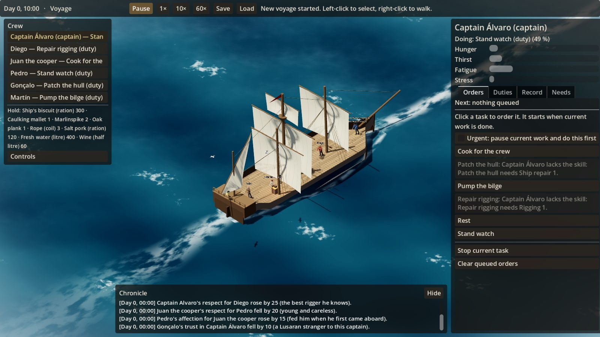

# The Expedition

A single-player isometric historical survival, expedition and settlement game set around
1500–1520. A persistent captain recruits a crew in a European port, sails for the Americas,
and survives what follows: a storm, a shipwreck, landfall and settlement. The same crew is
carried through every phase.



**Status:** building a playable voyage (D-015). V1 (the world around you) and V2 (the ship in danger:
leaks, weather, wear, supplies, landfall or foundering), V3 (events with choices) and V4 (hiring your
crew in port) are done. **Realignment (D-020):** the port becomes a living district next; see
[`docs/VISION_ALIGNMENT.md`](docs/VISION_ALIGNMENT.md).
P0 (simulation foundation) is complete. Characters with skills, attributes, traits,
relationships and appearance; tasks with queues and priorities; time, needs, provisions, inventories,
positions, a structured chronicle and versioned save/load. All of it is tested headless and shown in
a graybox Godot scene (`game/`). Next: P1, the first playable vertical slice.

## Build and test

Requires the [.NET 8 SDK](https://dotnet.microsoft.com/download/dotnet/8.0).

```bash
dotnet build
dotnet test
```

## Run the graybox scene (Godot 4.7.2 .NET)

Step-by-step guide for macOS: [`docs/TESTING_ON_MAC.md`](docs/TESTING_ON_MAC.md).

1. Open Godot 4.7.2 (.NET), choose **Import**, and select `game/project.godot`.
2. Click **Build** (the hammer, top right) once, then **Run Project** (▶, or Cmd + B on macOS / F5 elsewhere). The editor's own 3D view is empty by design; the scene is built when the game runs.

A new game opens in port, on the Bocana waterfront. **In port:**

| Input | Action |
|---|---|
| Right-click | Walk the captain there; the camera follows (F to follow again after panning) |
| Left-click anyone | Their card: what you know of them, who told you, how sure you can be |
| Card buttons | Talk, ask about someone, ask to see a skill, offer a berth; the captain walks over first |
| Port bar | Time to the convoy's departure, purse, berths signed, stores; Chandler's list; Set sail |
| Space, 1–6 | Pause, Watch (half a game minute a second), 2×, 10×, 60×, 240× |
| Esc | Close the card |

**At sea:**

| Input | Action |
|---|---|
| Left-click | Select a crew member |
| Right-click | Walk the selected crew member there |
| Right-hand panel, Orders tab | Order a task (dimmed tasks say why they are refused) |
| Right-hand panel, Duties tab | Choose what this crew member does on their own when idle |
| Space, 1–6 | Pause and time speed (up to 720×: a day in 2 seconds) |
| Voyage bar | Sail orders (press on, normal, heave to), short rations, repairs left |
| WASD / arrow keys, wheel, Q/E | Pan, zoom (zoom out to see the sails), turn the camera |
| Cmd+S / Cmd+L (Ctrl elsewhere), or F5 / F9 | Quick save / quick load |
| New voyage (top bar) | Start a fresh voyage; every launch also starts one |
| Tab | Select the next crew member |

Saves go to `~/Library/Application Support/The Expedition/saves/` on macOS.

## Assets

CC0 textures and sounds live in `game/Assets`, listed in `game/Assets/assets.json` with their sources
and authors in `game/Assets/CREDITS.md`. They are committed; `python3 tools/fetch_assets.py` fetches them
again or adds new ones from the list. Open the project in the Godot editor once after pulling new
assets so it imports them.

## Docs

- [`docs/GAME_VISION.md`](docs/GAME_VISION.md) — vision, design pillars, roadmap; gameplay authority (the Agent Handoff)
- [`docs/ART_BIBLE.md`](docs/ART_BIBLE.md) — visual authority: illustrated historical realism
- [`docs/TECHNICAL_SPEC.md`](docs/TECHNICAL_SPEC.md) — architecture and coding authority
- [`docs/SPEC_AUDIT.md`](docs/SPEC_AUDIT.md) — current code measured against the three documents
- [`docs/TECHNICAL_DESIGN.md`](docs/TECHNICAL_DESIGN.md) — proposed architecture and invariants
- [`docs/MILESTONES.md`](docs/MILESTONES.md) — ticket plan and status
- [`docs/DECISIONS.md`](docs/DECISIONS.md) — decision log
- [`docs/SETTING.md`](docs/SETTING.md) — the fictional setting (approved, D-013)
- [`docs/VISION_ALIGNMENT.md`](docs/VISION_ALIGNMENT.md) — where the build stands against the vision, and the re-plan (D-020)
- [`docs/PORT_EXPERIENCE.md`](docs/PORT_EXPERIENCE.md) — the port brief: authority for the port (D-023)
- [`docs/VOYAGE_EXPERIENCE.md`](docs/VOYAGE_EXPERIENCE.md) — the voyage and ship brief (D-024)
- [`docs/NAVIGATION.md`](docs/NAVIGATION.md) — the navigation and chart brief (D-024)
- [`docs/SETTLEMENT_EXPERIENCE.md`](docs/SETTLEMENT_EXPERIENCE.md) — the landfall and settlement brief (D-024)
- [`docs/UI_UX_DESIGN_SYSTEM.md`](docs/UI_UX_DESIGN_SYSTEM.md) — the interface authority for every phase (D-026)
- [`docs/COMMUNITY.md`](docs/COMMUNITY.md) — the community's condition and why, rations, working day and reserves ashore, self-sufficiency milestones
- [`docs/WORKPLACES.md`](docs/WORKPLACES.md) — workplaces led by a person, project priorities, why work stops, buildings' history
- [`docs/UI_STYLE.md`](docs/UI_STYLE.md) — the look: navy, gold and parchment, the fonts, icons, top bar and tabs
- [`docs/PORT_VISUAL_PASS.md`](docs/PORT_VISUAL_PASS.md) — the port visual slice: audit, approved plan (D-026)
- [`docs/P1_OPTIONS_BRIEF.md`](docs/P1_OPTIONS_BRIEF.md) — historical situations to draw inspiration from (setting is fictional: D-012)

## Tech

Godot 4 (.NET) for presentation, with a Godot-independent C# simulation library tested with
xUnit. Requires the .NET 8 SDK; the Godot 4.x .NET editor is needed only for scene work.
