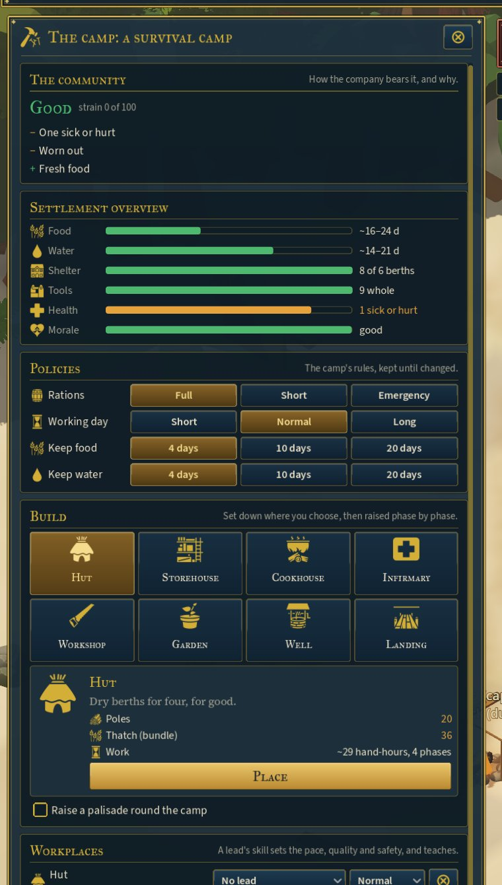
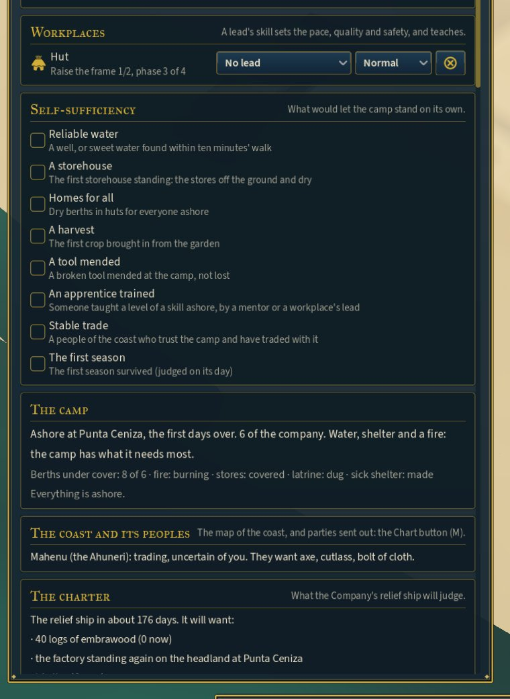

# The community: its condition, its policies, its milestones

**Spec:** ECONOMY_LOOP §18 (projections and rationing), §33 (community condition), §34 (policies) and §44
(self-sufficiency). This is step C of ECONOMY_AUDIT.
**Status:** first pass, 2026-10-23. The simulation is in `World/SimulationRunner.Community.cs`, and the
Camp drawer has three cards: The community, Policies and Self-sufficiency.

## How the community stands, and why

`Community()` gives a word for the company's strain, their stress on average:

| Strain | Under 25 | Under 45 | Under 65 | Under 80 | 80 and over |
|---|---|---|---|---|---|
| **Word** | Good | Steady | Strained | Low | Breaking |

It also gives the causes behind it, what weighs on them first and then what lifts them (§33):

| Weighs on them (−) | Lifts them (+) |
|---|---|
| Deaths in the last fortnight | Dry huts for all |
| The sick and hurt | Hot food from the cookhouse |
| Hungry, thirsty, worn out | A milestone lately, a building finished this week |
| Food or water running low | Fresh food |
| Short or emergency rations | The captain trusted |
| Long hours | Short hours: time to rest |
| Some with no cover at night | Friends among a people of the coast |
| Grievances held against the voyage | |
| No fresh food in a long while | |
| The captain not trusted | |
| A people of the coast hostile | |

The top bar's Morale reading uses the same word, everywhere, with the causes in its tooltip. Ashore, it
opens the Camp drawer.

## Policies

**Rations** (§18):
- **Full:** eat and drink when hungry or thirsty.
- **Short:** as before, food and water once a day each, about half.
- **Emergency:** water once a day, food only every other day, and twice the strain.

They apply at sea and ashore, and the chronicle records each change.

**The working day** (§34), ashore:

| | When the day's work ends | Rest | Strain |
|---|---|---|---|
| **Short** | Three hours sooner | Hands rest sooner | Some ease while not at work |
| **Normal** | As always | As always | As always |
| **Long** | Three hours later | Hands work on more tired | Strain while at work |

**Reserves** (§34):
- **What to keep:** 4, 10 or 20 days each of food and water. The camp gathers, fishes and fetches until
  that much is in hand (it was a fixed 4).
- **Below half the target:** water or food work goes to the front of everyone's duties, ahead of the
  captain's own order, until the store is back above half.

## Self-sufficiency milestones

Eight milestones (§44). Each is reached once, written in the chronicle ("The first storehouse stands…"),
and brings everyone ashore a little relief:

1. **Reliable water:** a sweet well, or sweet water within ten minutes' walk.
2. **A storehouse** standing.
3. **Homes for all:** dry berths in huts for everyone ashore.
4. **A harvest** brought in.
5. **A tool mended** at the camp.
6. **An apprentice trained:** a level of skill taught ashore, by a mentor or a workplace's lead.
7. **Stable trade:** a people met, trusting (20 and over) and not aggrieved, who have traded at least three
   lots.
8. **The first season** survived.

## Projections in ranges

`SupplyRange()` gives food and water as ranges, from hard work at the worst to the everyday rate at the
best, as the rations now serve them, before anything gathered. The Camp drawer's overview and the top bar
show them ashore: "Food ~16–24 d", "Water ~14–21 d" (§18: "avoid false precision").

## Saves

Format 43 keeps emergency rations, the working day, the reserves and the milestones reached. An older camp
works the usual day, keeps four days of each, and reaches its milestones again as soon as it next meets
them.

## Tests

`CommunityTests` (7):
- emergency rations eat less and weigh heavier than short;
- the working day moves when work may be begun, and long hours strain more than short;
- below half the reserve, water comes first;
- a milestone reached once, with relief;
- the condition and its causes;
- the ranges;
- all of it saved and loaded alike.

All 612 tests pass. The test captain keeps the default policies, so the day-180 balance is as it was,
apart from the reserves putting water and food first when they run low.

## Not yet

- **Causes that act:** a harvest or a finished building is named as a cause, but only the milestones and
  the policies change the strain. Food variety, crowding and belonging come with households (step P).
- **Other policies:** emergency labour, trade restrictions and exploration priority (§34).
- **Ranges at sea:** the voyage's readings already give ranges of their own; they are not yet the same
  measure as the camp's.
