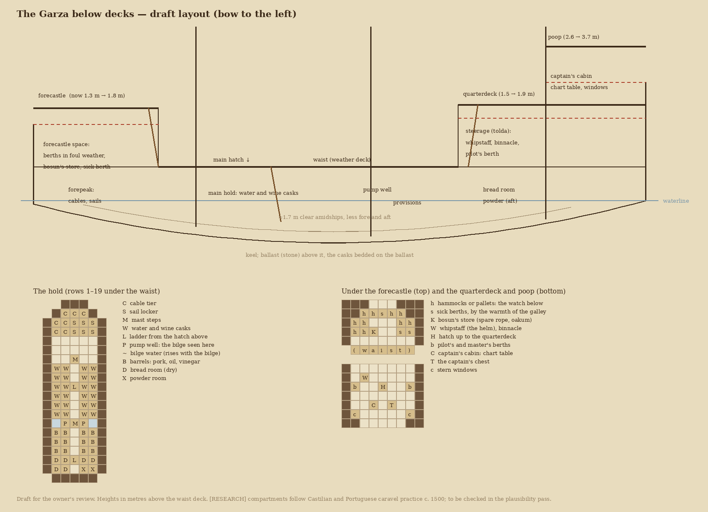
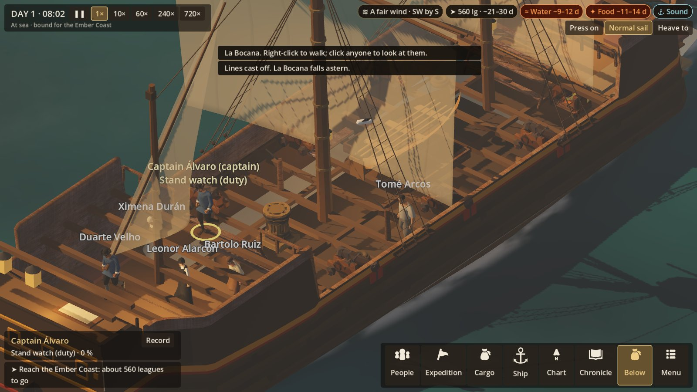
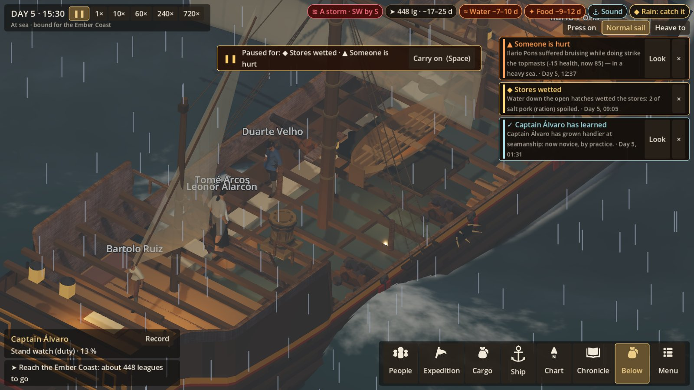

# The Garza below decks

**Status:** built (2026-10-22), on the owner's answers: "yes raise the decks, keep helm on quarterdeck,
boat in waist". The sleeping question went unanswered; it follows the period (on deck in fair weather,
under the forecastle in foul). What was built, and what is left, is under **As built** at the end.
The draft below is kept as the record of the design.
**Authority:** VOYAGE_EXPERIENCE §3 (the ship as a physical play space), §31–33; ART_BIBLE (cutaways
rather than enlarged rooms); SETTING §4 (a caravel of about 60 tons, 16–20 aboard, two pumps, a galley
fire box, a hold for about 2 tonnes of stores).

## What she is, and what that allows

She is about 22 m long and 7 m inside the bulwarks. From the waist deck to the keel is 2.35 m, and the
waterline is 1.05 m below the waist. A caravel of her size has **one deck over the hold, and no deck
between**. Historically:
- her people slept on deck, or under the forecastle in foul weather;
- the officers berthed aft, under the quarterdeck and the poop;
- everything else went in the hold, on the ballast.

So her inside is three kinds of space, not a deck of cabins:

1. **The hold**, under the whole waist. It is low: about 1.7 m clear amidships over the ballast, and
   less towards the ends.
2. **The forecastle space**, under the forecastle, at waist level.
3. **The steerage and the captain's cabin**, under the quarterdeck and the poop, at waist level.

## The one change needed outside

Under her raised decks as they stand there is no headroom. The forecastle is 1.3 m above the waist,
the quarterdeck 1.5 m, and the poop only 1.1 m above the quarterdeck. The draft raises them to period
proportions, with room to stand under each:

| Deck | Now | Proposed | Headroom under it |
|---|---|---|---|
| Forecastle | 1.3 m | 1.8 m | about 1.7 m |
| Quarterdeck | 1.5 m | 1.9 m | about 1.8 m (the steerage) |
| Poop | 2.6 m | 3.7 m | about 1.7 m (the captain's cabin) |

This is a change to her model's data: `tools/gen_garza_deck.py` and `tools/ship/garza.json`, then a
rebuild. The ladders grow a step or two. She will look a little higher at the ends, as caravels drawn in
the period do.

## The spaces, and what each is for in play

**The hold** (rows 1–19, reached by a ladder down the main hatch, and a scuttle aft from the steerage):

| Space | Rows | What is there | What it does in play |
|---|---|---|---|
| Forepeak | 1–3 | Cable tier, sail locker | Spare sail and rope for repairs are fetched from here. |
| Main hold | 7–12 | Water and wine casks in tiers on the ballast | Casks visibly go as they are drunk; unlashed, they break loose in a seaway (R4e); wetted stores show here. |
| Pump well | 13 | The two pumps' tubes down to the bilge, by the mainmast step | The bilge water is drawn rising and falling here and along the hold's floor. |
| Provisions | 14–16 | Barrels of pork, oil, vinegar | Stores visibly go down. |
| Bread room | 17–18 | Biscuit, kept dry | Wetted when the hatches are open in heavy weather (R4e). |
| Powder room | 18 | Powder for her few guns, aft and dry | Nothing yet; a place for later. |

**Leaks** are already sprung at named places: the starboard bow, the larboard waist, under the counter,
the garboard strake. Each would show as water spurting at its place in the hold, and a plug or patch
there once it is met.

**The forecastle space** (rows 1–4):
- **Pallets or hammocks:** where the watch below sleeps in foul weather. In fair weather they sleep on
  deck in the waist, as they did.
- **Sick berths:** by the warmth of the galley's fire box above. The sick and their tender go here
  (R4f).
- **The bosun's store:** spare rope, oakum and tools.

**The steerage** (rows 18–20, under the quarterdeck):
- **The whipstaff:** the helmsman stood here, below the quarterdeck, with the binnacle, conning by
  the officer's word from above through a hatch. Today the game puts the helm on the quarterdeck: the
  draft moves it down here, where it belongs. *(Owner's call: it puts the helmsman out of sight from
  above until the cutaway is used.)*
- **The pilot's and master's berths.**

**The captain's cabin** (rows 21–23, under the poop): the stern windows the model already has, the
chart
table (the chart opens here), and the captain's chest (the purse, the papers).

## How it would be seen and walked

- **The cutaway:** a key and a button ("Below") takes away the planking of the weather deck and the raised decks, to show
  the hold, the forecastle space, the steerage and the cabin. The camera is otherwise unchanged. People
  below are drawn faintly through the deck when the cutaway is off, so no one vanishes.
- **Two levels in the simulation's grid:** the deck as now, and the hold beneath, joined by the main
  hatch ladder and the aft scuttle. The covered spaces fore and aft are on the deck level already;
  they only gain their dressing and their uses. Pathfinding crosses between levels by the ladders.
- **Where the work goes:**
  - Sleep below: the berths.
  - Tend the sick: the sick berths.
  - Pump: still on deck (the pumps were worked from the deck), with the water seen in the well below.
  - Plug and patch: at the leak's place in the hold.
  - Lash the cargo: in the hold.
  - Fetch stores: from where they are kept.
- **Sound** (VOYAGE §33): muffled sea and wind, timbers loud and close, voices overhead, when the
  camera is below.

## Open questions for the owner

1. **Raise the forecastle, quarterdeck and poop** as above, so the spaces under them can be stood in?
   *(Recommended; the alternative is low spaces that people crouch in.)*
2. **Move the helm down into the steerage**, where a whipstaff was worked from? Or keep it on the
   quarterdeck for readability?
3. **The ship's boat:** carry it in the waist on the main hatch, as was usual, which closes the hatch
   at sea except by the boat's side? Or tow it astern?
4. **Sleeping:** on deck in fair weather and under the forecastle in foul, as was done, or always
   below for readability?

[RESEARCH] The arrangement follows Castilian and Portuguese caravel practice around 1500: no lower
deck at this size; officers aft under the tolda and toldilla; a bread room and a powder room aft in
the hold; the forepeak for cables and sails. It is to be checked in the ship's plausibility pass.

## As built (2026-10-22)

**The owner's answers.**
1. **The raised decks are raised:** forecastle 1.8 m, quarterdeck 1.9 m, poop 3.7 m.
2. **The helm stays on the quarterdeck.**
3. **The boat rides in the waist,** over the main hatch.
4. **Sleeping** (unanswered): on deck in fair weather, under the forecastle in foul.

**In the simulation.**
- **The levels:** the hold and the covered spaces are laid out beside the deck in the same grid. Ladders
  join them: the main hatch, the aft scuttle, and the doors of the forecastle, the steerage and the cabin.
  Pathfinding crosses by them.
- **Where people go:**
  - **Sleep:** berths under the forecastle, the steerage's two berths, and six places in the waist.
    Indoors in rain or a sea of 1.25 and over; on deck otherwise.
  - **The captain's cabin** is kept for the captain alone.
  - **The sick** go to the two sick berths, and whoever tends them goes with them.
  - **A leak** is met at its own place in the hold.
  - **The cargo** is lashed in the hold.
- **The pumps** are still worked from the deck.

**In the view.**
- **The cutaway** (the *Below* button, or B, at sea) takes away the planking of every deck and leaves
  the beams. Under them you see:
  - the hold: cables and sails forward, the cask tiers, the provision barrels, the bread room and the
    powder;
  - the berths and the sick berths;
  - the cabin's table and chest.
- **What it follows:** the casks and barrels go as the water and food are used. The bilge water rises
  in the hold. Each leak spurts at its place until it is plugged.
- **Lantern light** below; the sea is cleared from inside the hull. The sea sounds muffled while the
  cutaway is on.
- **People below** are drawn only when the cutaway is on.

**Balance.** The ten test crews keeping watches: 6 of 10 arrive, average fatigue about 31 (it was 4 of
10, about 27). The other four foundered, between days 24 and 33.

**Not yet done.**
- Walking someone into the levels below by right-click.
- People below drawn faintly through the deck when the cutaway is off.
- A dedicated below-decks sound bed: today it is the muffled sea only.
- The hold is lit by daylight through the open deck in the cutaway. That reads, but a darker, lantern-lit
  hold would be truer.
