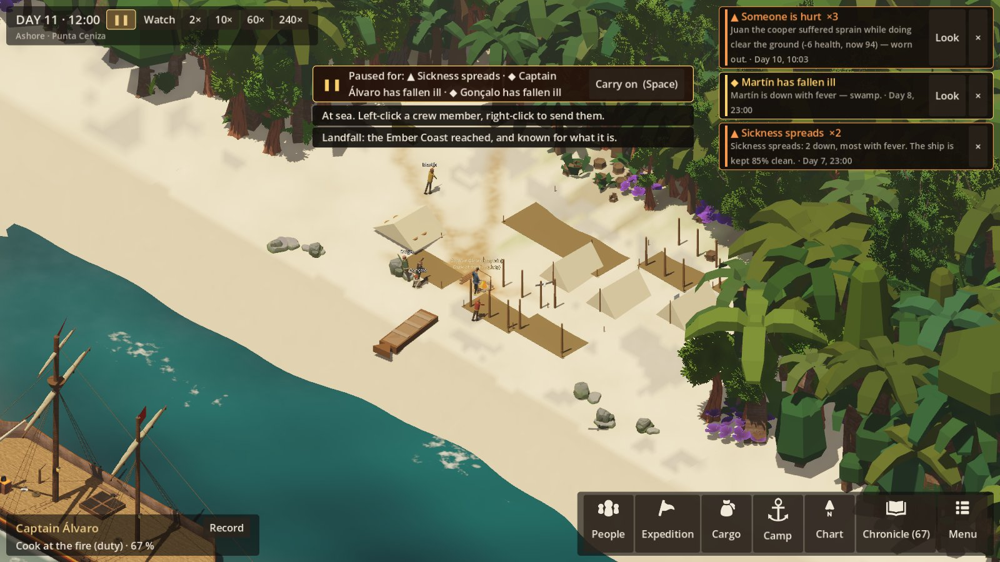
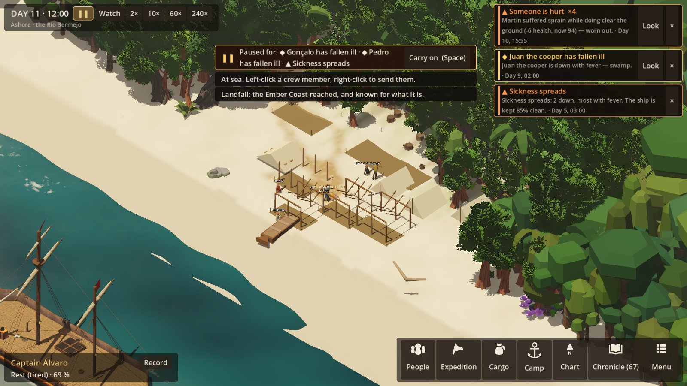
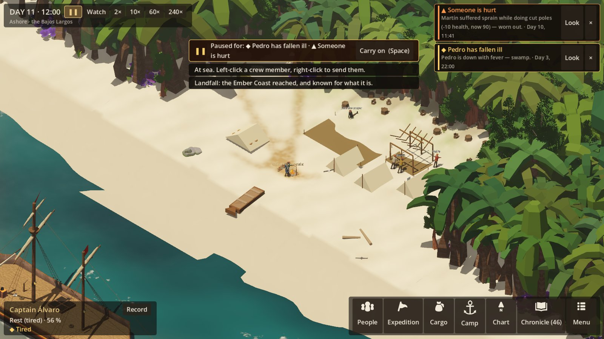
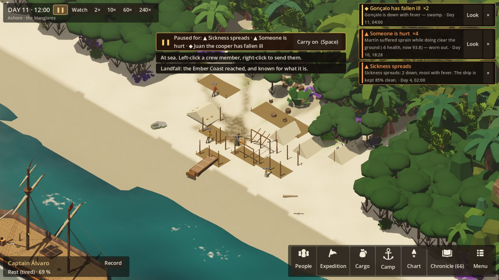

# Natural ground: each site's own forest, the coast's vegetation, paths as tracks

**Owner's asks:**
- "the forest and terrain needs more variation";
- "the paths need to be more natural/procedural, not cookie cutter appearing in blocks";
- "can we update our vegetation? surely we can find some free assets to make it prettier, find variation".

**Status:** first pass, 2026-10-22.

## Each site has its own ground (simulation)

The camp's grid used to be one hand-made map for every landing site. Now `Shore.CampGround` makes each camp's
ground from the beach's plan (`data/locations/shore_camp.json`), the site's lie of the land, and the voyage's
seed. The same site and seed always give the same ground: it is made again on loading and never saved.

**Lie of the land:** each site has one, set as `"ground"` in `data/shore.json`.

| Ground | Site | What it is like |
|---|---|---|
| `headland` | Punta Ceniza, Punta Falsa | Rocky; the trees thinner and set back; rocks on the beach |
| `river` | the Río Bermejo | The forest close and thick |
| `dunes` | the Bajos Largos | A wide beach; scrub far back; palms |
| `mangrove` | the Manglares | Close, low and dense; mud at the water |
| `forest` | (the default) | Between these |

**What the seed shapes:**
- The forest's edge runs in bays and points: two waves of different length laid over each other.
- Groves stand out on the sand, and there are clearings inside the trees.
- Rocks lie on the beach.
- The ways in are lanes cut through the trees and lined by them: the scout's way on the left, the water path
  on the right. So a hut across one still shuts it.

**What is guaranteed:**
- Every work place stays open and can be walked to from the hearth.
- The camp's own ground, where the shelters go, is never wooded.

**In the simulation:** wherever the camp's location is looked up, `SimulationRunner.Location(id)` gives this
ground: pathfinding, placement, trees to fell, regrowth. Loading a save makes the same ground again, and checks
each person's cell against it.

**Tests:** `CampGroundTests` (5):
- the same site and seed give the same ground;
- each voyage and site has its own edge;
- the river is thicker than the dunes;
- every work place stays reachable, on every ground and 40 seeds;
- the camp uses its own ground, made again on loading.

## The coast's vegetation (view)

Two CC0 packs, fetched by `tools/fetch_assets.py` and credited in `game/Assets/CREDITS.md`. No credits were
spent.

**Kenney Nature Kit** (`Assets/Nature/`, 58 models):
- six palms;
- low-poly broadleaf trees for the far forest;
- stumps, logs, and fallbacks for the undergrowth.

The kit's own colours are a bright mint palette. Each part is given the coast's colours instead, by what its
material is: leaves green from the coast's palette, bark brown, stone grey.

**Quaternius Stylized Nature MegaKit, free edition** (`Assets/Nature/MegaKit/`, 36 models), textured:
- broadleaf and twisted trees near the camp;
- bushes, ferns and broad-leaved plants;
- grasses and clover;
- a few flowers and fungi;
- rocks and pebbles.

Its textures are scaled to 512 px. Its foliage masks, which its own shader would colour, are made a ramp of
the coast's greens when fetched. Each leaf material is kept in a few tinted copies, so a stand of one model is
not all one green.

**What grows where**, by the site's ground and how far into the trees:
- **Palms** along the sand's edge: most on the dunes and headlands, few by the river.
- **Broadleaf** behind the palms.
- **Tall twisted trees** standing over the rest further in.
- **Mangroves** on their prop roots in the wet.
- **Undergrowth** under all of them.

**Performance:**
- Near the camp, the textured trees are nodes of their own, so they can be felled.
- Further back, the lighter Nature Kit trees are batched.
- Undergrowth and rocks are batched.

**Ground:**
- dry pale ridges and darker hollows;
- creeper and grass running out onto the sand below the trees, in tongues;
- leaf litter under the trees;
- rock breaking through on the headlands;
- wind ripples on the dunes;
- mud in the mangroves.

The sand rises and falls a little, more on the dunes, least over the camp's middle. Colours are set at each
corner of the ground, so they blend and no square shows.

## Paths as tracks (view)

Paths still come only where feet go (R7), but they are no longer laid in discs and strips:
- The worn cells are painted into one soft layer over the ground, eight texels to the metre.
- Each cell is a soft splash, a little off its cell's centre, and neighbours are joined by a band of splashes.
- The whole is blurred, so the grid's steps round off into curves.
- Its edges are broken by noise.

Ground given up and greening over is painted the same way, earth and then grass, with the scrub coming up
through it.

## Screenshots

## Not yet

- **No palm in the MegaKit's free edition,** so the palms are the Nature Kit's, and plainer than the rest.
- **No grass tufts on the open sand:** buildings could be set down over them.
- **Saves made before this pass** load onto the new ground: a building may stand where a tree now is.
