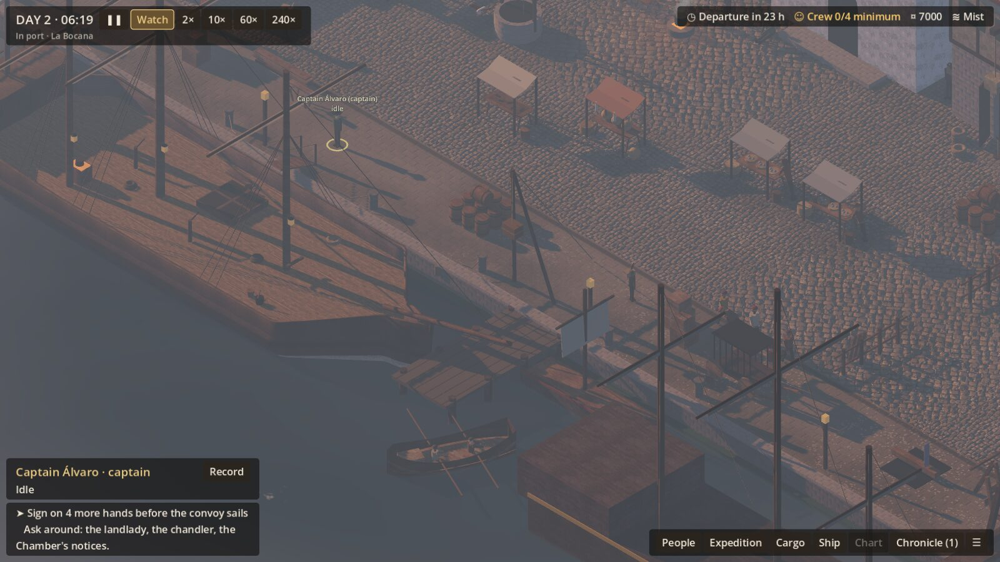
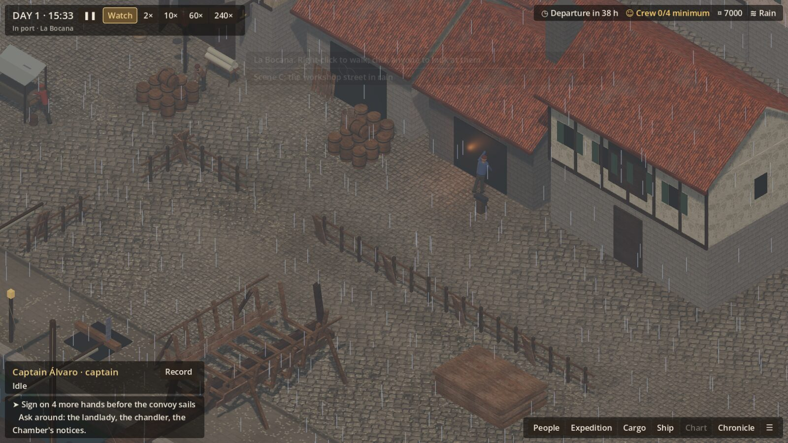
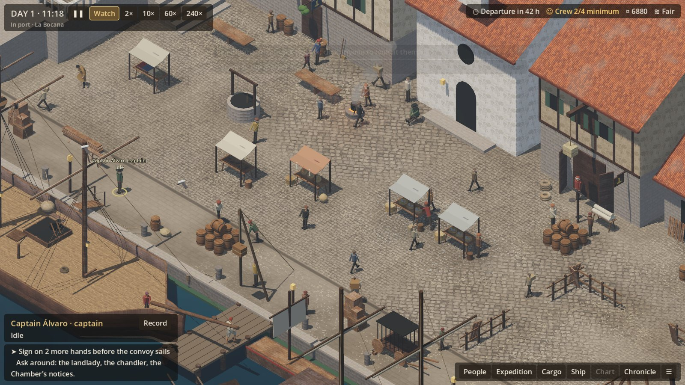
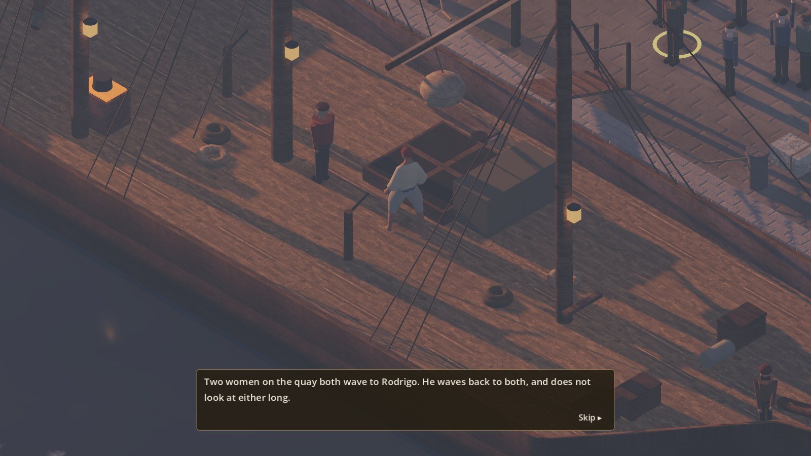
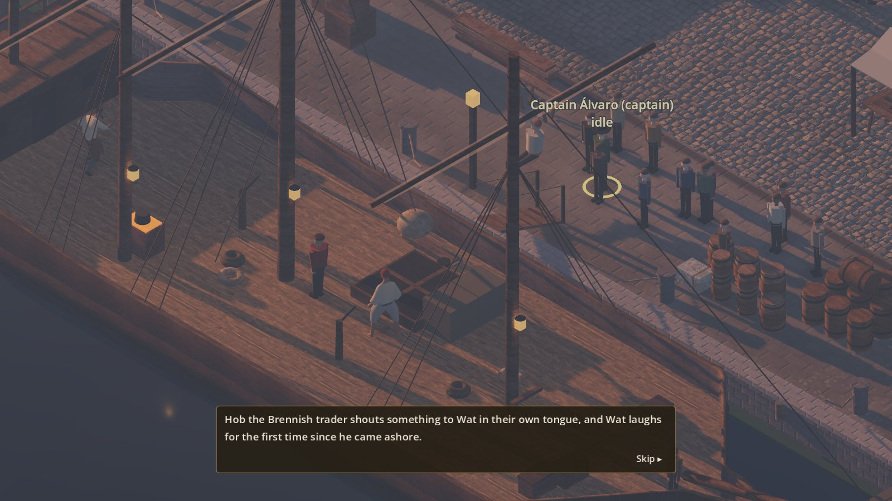

# R3 — The four port validation scenes

**Authority:** PORT_EXPERIENCE §21 (four scenes), §23 steps 15–16 (validate, then profile); D-028
(R3 in two parts).
**Status:**
- **Part one** (2026-10-19): scenes A and C are judged; all four are staged; the profiling baseline
  is taken here.
- **Part two** (2026-10-20): scenes B and D are judged, now with the six characters of C-1 in place. The owner's Mac profile is still outstanding.

The brief asks that these scenes be proved *before* asset production is scaled. Each verdict below
is honest: **Yes**, **Partly** or **No**, against the tests the brief names.

## How to stage a scene

Each scene is staged the same way every time: a fixed seed (1519), run on to its hour, with its
weather, hands and stores, and the camera on it.

| Scene | Launch option | In-game (debug build) |
|---|---|---|
| A: the quay at dawn | `--stage=dawn-quay` | Ctrl+1 |
| B: the market at midday | `--stage=midday-market` | Ctrl+2 |
| C: the workshop street in rain | `--stage=rainy-workshops` | Ctrl+3 |
| D: departure morning | `--stage=departure-morning` | Ctrl+4 |

Options go after `--` on the Godot command line. From the editor, put them in Project → Project
Settings → Editor → Run → Main Run Args.

## Scene A: the quay at dawn — *Partly*



Day 2, 06:18, in the new **mist** weather. Mist is a morning weather that lies low on the water,
thins the far ships and burns off to fair. The camera looks at the east pier, where the dockers carry
to the lighter.

| Test | Verdict | Notes |
|---|---|---|
| Lighting | **Yes** | Low warm sun from the east, long shadows, cool haze. It reads as early morning. |
| Water | **Partly** | Haze lies on the harbour and the far water fades. But the mist is a thin even veil, not banks drifting on the water. |
| Ship scale | **Yes** | The Garza dominates the quay; the lighter and boats read small against her. |
| Silhouettes | **Partly** | Masts, shear-legs and stalls read clearly. People are too small and too alike to read at this distance (C-1). |
| Sound layering | **Partly** | Recorded surf, creaking timbers and the first mallets layer by distance. Gulls, oars and the fish market starting up are missing. |
| Fishermen and dockers starting the day | **Partly** | The schedules start at 06:00 and a few dockers are moving. But at 06:18 the quay is still thin, and the catch is landed at the west pier, out of this frame. |

**Fixed in this pass:**
- Mist added as its own weather. The anchored nao vanishes into it, and the caravel stays a shape.
- Light mist now lies low (height fog). Only thick fog closes in on everything.
- The scene is framed on the work, not the empty middle of the quay.

**Still to do:**
- Drifting mist banks on the water. These need a cheap animated mist layer.
- The catch landing and the dockers' first carries together in one frame. This needs either a
  wider establishing view, or the fishing boats landing nearer the lighter.
- More dawn sound.

## Scene C: the workshop street in rain — *Partly*



Day 1, 15:33, in rain, on the yard and the workshops (cooperage, smithy, sail loft).

| Test | Verdict | Notes |
|---|---|---|
| Wetness | **Yes** | The stone darkens and shines, roofs and timber darken, and everything dries slowly afterwards. |
| Rain response | **Partly** | Rain falls, the sound bed is recorded, stalls are covered and the sailcloth is taken in. Puddles and dripping eaves are missing. |
| Interiors and exteriors | **No** | The workshops are solid boxes with dark doorways. You cannot see in, so "the smith at work inside" reads only as a glow. |
| Weather behaviour | **Partly** | Idlers and outdoor menders go to shelter. The smith works on at the forge door, and the cooper and ropemaker work on. But the street looks empty rather than adapted: no one hurries, holds a sack over their head, or works under an eave. |

**Fixed in this pass:**
- The sailcloth spread in the yard is taken in when it rains.
- Cloth (awnings, banners, the ensign) ripples in the wind.

**Still to do:**
- Open-fronted workshops, so the work is visible from the street. This is a new building kit, needed
  for every craft.
- Craftsmen moving to work under cover, not only stopping.
- Puddles, and drips from the eaves.

## Scene B: the market at midday — *Partly*



Day 1, 11:18, fair, on the market square between the quay and the church.

The stage first ran at noon, the one hour the market is empty of anyone named: at noon every named
person goes indoors to eat and drink. It now runs late in the morning.

| Test | Verdict | Notes |
|---|---|---|
| Crowd readability | **Partly** | 40-odd people read as individuals at the default zoom. Each is doing something you can name: selling, carrying, walking a route, standing at a stall. But the simple figures are all one height, one build and the same few colours, so the crowd reads as a pattern. Of the six with models, only Pons is in frame (his tawny coat, top left), and he stands out from the crowd as a different kind of figure. |
| Props | **Partly** | Stalls, awnings, a well, a cook-fire, cask stacks and handcarts. But the stall tables are nearly bare: the goods for sale (fish, bread, cloth, pots) are a few blocks, not piles. |
| Colour hierarchy | **Yes** | Warm stone and white limewash, terracotta roofs, pale awnings. People are the strongest colour, as the art bible asks, and nothing in the UI competes with the world. |
| NPC activity | **Partly** | Sellers at their stalls, porters, idlers and walkers on routes, the captain greeted in passing. But there is little exchange to see: no one hands anything over, haggles or carries a purchase away. |
| UI legibility | **Yes** | The clock, departure countdown, crew, purse and weather read at a glance. Labels appear only for the captain and whoever is pointed at. The new recruiting rim marks the people who matter without labels. |

**Still to do:**
- Goods piled on the stalls: the props kit for market wares.
- Visible exchange between sellers and buyers.
- Models for every recruitable person (C-2, below), so the people the player is choosing between
  stand out as people, not as box figures.

## Scene D: departure morning — *Partly*




Day 3, 05:40, fair. Seven signed on: Velho, Pons, Bartolo and Rodrigo (with models), and Gil, Wat and
Pascual. The departure plays as soon as the scene is staged.

| Test | Verdict | Notes |
|---|---|---|
| Emotional readability | **Partly** | The words carry it: Rodrigo's two women, Pascual's mother, Hob shouting to Wat in Brennish, Velho touching the stones. The pictures carry less. People who come to see someone off now walk to the quay edge and wave, and the camera frames the hand and them together. But the figures are small, their gestures are few (a wave, a talk), and no one embraces, hands something up or turns away. |
| Persistent identities | **Partly** | When a farewell is about one of the six, the camera closes on them and they are recognisably themselves: Bartolo bent over, Rodrigo barefoot in his red cap, Pons in his long coat. The other hands (Gil, Wat, Pascual) are simple figures and do not. |
| Crowd tiers | **No** | The six with models, the simple figures for everyone else named, and the crowd walkers are three different looks side by side. A recruitable man like Gil, whom the player may have chosen over Bartolo, looks like a box. CHARACTER_ART §37: recruitable people must never use disposable identity. |
| Ship state | **Yes** | The stores still on the quay go up in their kinds and numbers (sacks, casks, coils, planks), the hold is read out, the lanterns are lit, the gangway comes in and the lines are cast off. The Garza is visibly ready, and visibly loaded with what was bought. |
| Procedural farewell staging | **Partly** | Built from the expedition as it is: who sailed, who has come for them (named people walk to the quay: Hob for Wat, the guard for Tomé, Catalina for Ximena, Inés for Nuño), how many wave, who sails alone, and Varzi coming down to sign. But the gathering is a static crowd with a few wavers, not people arriving, pressing forward and dispersing. |

**Fixed in this pass:**
- **Sunrise at six:** the convoy sails at dawn. The departure was playing in pre-dawn dark (sunrise
  was at 06:30), and is now a low gold light.
- **Camera:** it closes on each hand while their farewell is told, and frames them with whoever
  came to see them off.
- **Farewells staged:** the people named in a farewell come to the quay edge and wave, and
  anonymous wavers step out of the crowd. This comes from the data (`farewellBy`,
  `farewellWavers`).
- **Varzi** comes down to the gangway to sign the clearance, and the camera is on him. After the
  convoy has gone, he sends a clerk instead.
- **The stage** now signs on the crew by name, so the six are in it.

**Still to do:**
- **C-2:** models for all recruitable people, and a matching style for named locals and the crowd.
  This is the largest gap the four scenes show.
- **Gestures:** an embrace, handing up a bundle, turning away. The animation library has none of
  these; they need clips.
- **The gathering:** arriving through the dawn, pressing to the edge as the gangway comes in, and
  breaking up once she is away.

## What the four scenes say

None of the four is a clean *Yes*. Each shows the world working, and something specific missing.
In order of what would most improve the port:

1. **People (C-2):** models for every recruitable person, and a matching style for named locals
   and the crowd. Scenes B and D both fail on this: the six of C-1 look like people, and everyone
   beside them looks like a box. The pipeline from C-1 can build them; the gap is identity
   records.
2. **Open-fronted workshops (scene C):** craft visible from the street.
3. **Goods and exchange (scene B):** piled wares on the stalls, and buying you can see.
4. **Farewell gestures and a living gathering (scene D):** new clips, and the crowd arriving and
   dispersing.
5. **Mist banks and dawn sound (scene A).**

## Profiling

**Here** (a CPU software renderer, so frame times mean nothing; the counts are the baseline). Each
capture is 20 seconds, with the camera circling slowly over the scene.

| Scene | Draw calls (mean / most) | Primitives | Objects | Crowd |
|---|---|---|---|---|
| A: dawn quay | 370 / 406 | 283k | 648 | 24 |
| B: midday market | 575 / 601 | 389k | 858 | 40 |
| C: rainy workshops | 322 / 367 | 331k | 614 | 10 |

These leave room under common desktop budgets (about 1–2,000 draw calls, a few million primitives),
but the real test is the Mac.

**On the Mac (the owner):**
1. Run each scene with profiling:

   ```
   /Applications/Godot_mono.app/Contents/MacOS/Godot --path game -- --stage=midday-market --profile
   ```

   Or press F10 in the game on any view.
2. Each capture saves a report and prints its path. The path is under
   `~/Library/Application Support/Godot/app_userdata/The Expedition/profiles/`.
3. Send the four reports. They give the frame time (mean, median, 95th and 99th percentile), what was
   drawn, and the GPU.

C-1's budgets (D-028) are confirmed or adjusted against these numbers.
