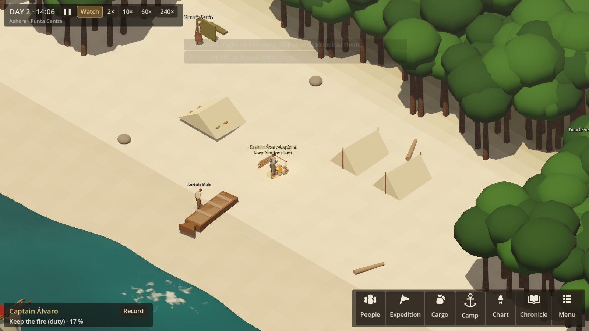
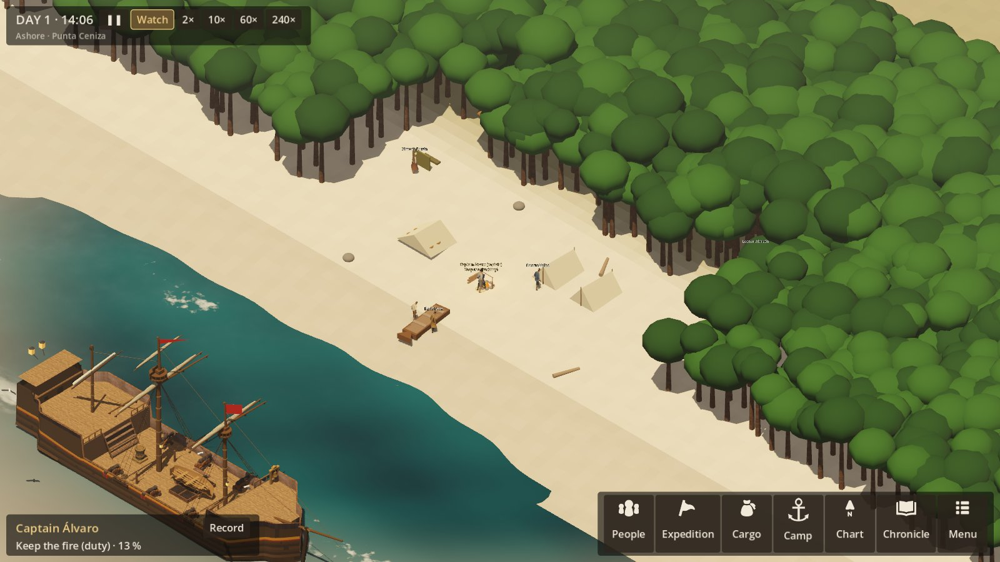
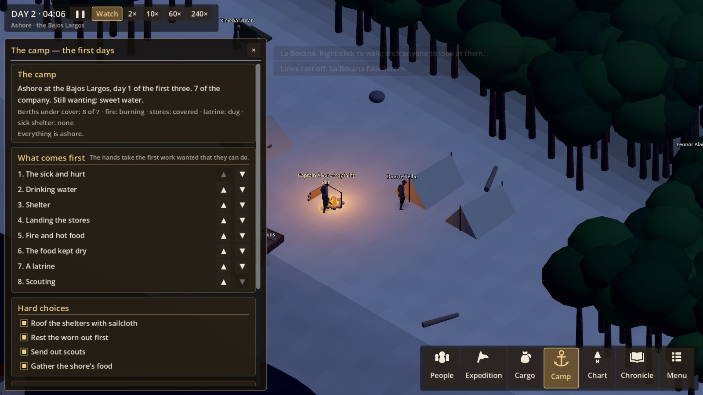
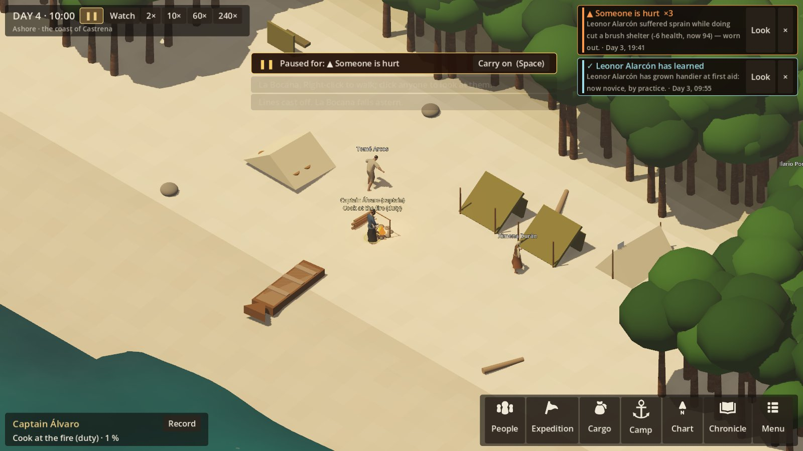

# R6 — The landfall camp: the first 72 hours

**Status:** built (2026-10-22), on the owner's word: "cleanup pass first, then R6". What was built, and
what is left, is under **As built** at the end.
**Authority:** SETTLEMENT_EXPERIENCE §1, §3–6 (the assessment, the first 72 hours, the site, the
camp stage); SETTING §5 (the Ember Coast, Punta Ceniza); VOYAGE_EXPERIENCE §39–40 (the wreck as a
transition).

## What it is

The voyage ends in one of two ways:
- **Arrived:** she comes to anchor off the coast.
- **Wrecked:** the survivors come ashore from the wreck or the boat.

Either way the campaign goes on, on the shore, with the same people. They keep their injuries,
fatigue, quarrels and skills, and the stores they actually have. The first three days are survival,
not building: water, shelter, fire, the stores, the sick. The captain sets the priorities; the hands
do the work; the weather and the shore decide how it goes.

## The shore

**Every landing site is described in `data/shore.json`:** each coast landmark, the coast of Castrena,
and the islands, with a default for anywhere else. For each site:
- **Water:** its sources (a spring, a stream, a brackish seep). Each has how far it is, how much it
  gives, and whether it is known on landing. Punta Ceniza's spring is in the sailing directions;
  most others have to be found.
- **Food:** what can be taken (shellfish, fish, fruit), and whether it is unfamiliar. Strange food eaten
  without anyone who knows it can bring on the flux.
- **What there is to build with:** brush and poles, and at Punta Ceniza the burned factory's timbers.
- **Hazards:** fever from the lagoon at night; surf that stops the boat.
- **Signs of people:** paths, a fish weir, smoke. These are signs only. Meeting the coast's people is
  R8; R6 never makes them up as enemies or as empty land.

**The captain does not know the site** (SETTLEMENT §3). The assessment says what is seen, and what is
only guessed: "Water: none seen. Birds go inland at dusk." Scouting finds the rest.

## The camp (simulation)

`Campaign.Camp` (save format 37) holds:
- the site and when they landed;
- each work of the camp and how far along it is;
- what has been found;
- what is still afloat: the wreck's remains, or, when she is at anchor, her hold;
- the nights each person spent sheltered or out in the open.

**The works** (SETTLEMENT §6), each a task done at its place in the camp:

| Work | Task | What it does |
|---|---|---|
| Shelter | Rig a sail shelter (uses the spare sailcloth) or cut a brush shelter | Each holds so many. Without one, a wet night brings chills and fever, and no rest. The sail's is quicker and drier, but the sail is gone for mending her. |
| Fire | Make a fire, then keep it | Hot food (more from a meal); a warmer night; heart. |
| Water | Fetch water from a found source | Water casks filled. Brackish water risks the flux. |
| Stores | Land the stores (the boat, from the ship or the wreck), then cover them | Stores ashore, in trips, as the surf allows. Uncovered in rain, food spoils. |
| Sanitation | Dig a latrine | Without one the camp grows foul, and the flux comes, as on board. |
| The sick | A sick shelter; tend the sick | As on board (R4f), out of the rain. |
| Reconnaissance | Scout | Finds the next thing about the site: water, food, signs, the factory. Alone and away, with some risk. |

**The captain's priorities:** the eight of SETTLEMENT §4, ranked. Idle hands take the first unmet
work they can do. There are also four choices, each one of §4's tradeoffs:
- use the sailcloth for shelter, or keep it for the ship;
- rest the exhausted, or work them;
- scout, or keep together;
- eat the ship's stores, or forage.

**Weather ashore:** rain by the hour, from the site's season. It is as deterministic as at sea.

**After 72 hours:** the first days' report. Is there water, and how far? How many slept sheltered?
Who fell sick, who was lost? What was landed, and what is still afloat? What was found? What signs of
people were seen? The camp then carries on; establishing a settlement is R7.

## The camp (view)

- **The scene:** a strip of beach with the forest behind it. Offshore lies the wreck, or the Garza at
  anchor. The boat runs between them.
- **The camp's works appear as they are made:** a sail or brush shelter, the fire and its smoke, casks
  at the water place, the stores under canvas, the latrine, the sick shelter.
- **The HUD:**
  - **"The first days":** the priorities with their state, the choices, and what is afloat.
  - **The landing:** the assessment card.
  - **The report:** after 72 hours.
- **Sound:** surf, wind, rain, fire. These are the recorded beds already in hand.

## Not in R6

- Building in earnest, storage and spoilage over seasons, gardens (R7).
- Meeting the Ahuneri or the Tesiwa (R8).
- Moving the camp to another site (§5 site selection). R6 records the site's merits so R7 can offer
  the move.
- Repairing the Garza to sail again.

## As built (2026-10-22)

**Simulation** (`SimulationRunner.Camp.cs`, `Shore/`, `data/shore.json`, `data/tasks/shore.json`,
`data/locations/shore_camp.json` from `tools/gen_shore_camp.py`):
- **Going ashore** (`GoAshore`):
  - **Arrived:** everything is still aboard her, with her spare sail (6 cloths). The boat brings the
    first load in with the people: no more than 160 kg, at most half of it water, and the sail and rope
    first if the shelters are to be of sail.
  - **Wrecked:** what the boat saved is ashore, with the boat's sail (2 cloths). If she broke up on that
    coast, what is left in the wreck, and half her spare sail, can be landed.
  - **On landing:** everyone's ship work and orders are dropped, and the camp's work becomes their
    duties.
- **The hands' work:**
  - **Priorities:** the hands take the first work wanted, in the captain's order.
  - **No overbuilding:** a work counts what is being built as well as what is done, so the hands don't
    all set to the same thing.
  - **The sick:** one hand tends each three sick or hurt.
  - **Time of day:** scouting, foraging, fetching water, landing stores and cutting brush are daytime
    work.
  - **Scouts:** a scout must be rested (fatigue under 45) to set out. Neither a scout away nor a boat
    crew can be called back.
  - **The helm:** the hand at the helm is no longer called off to other work (an earlier fix).
- **Scouting** finds, in order, water, then a ruin in plain sight, then food, then the rest. The chance
  each trip is 0.6, plus 0.1 a level of tracking or foraging.
- **Each hour:**
  - **Rain:** worked out from the seed and the site's rain.
  - **Wet nights:** a wet night in the open adds fatigue and stress, and may bring a chill (a fever);
    a fire halves it.
  - **Swamp fever** comes at night, where the site has it.
  - **Stores:** in rain, uncovered stores spoil.
  - **The latrine:** without one the camp grows foul (4 a day); with one it comes back (2 a day).
  - **Sickness** comes and spreads as aboard.
  - **First light:** the night is tallied for each person, under cover or in the open.
- **Food and water:** strange shellfish picked by someone without foraging 2, and brackish water, may
  bring on the flux.
- **After 72 hours:** the first days' report, then the settlement phase.

**View** (`CampView.cs`; Main, Hud):
- **The beach:** wet sand at the surf, then sand, then the forest's edge. The forest goes on behind and
  on both flanks, and there are driftwood and rocks.
- **The works**, drawn as they stand:
  - sail tents or brush lean-tos;
  - the hearth with its kettle bar and stacked wood; flames and firelight while it burns;
  - the stores in casks and sacks, under canvas once covered;
  - the latrine and its screen;
  - the sick shelter with pallets and a pale cloth;
  - the water casks once water is found;
  - the boat drawn up, gone while a load is being landed.
- **Offshore:** the Garza at anchor, sails furled and her boat gone from the waist. A wreck lies close
  in, heeled and settled. Foundered at sea, she is gone.
- **The flow:**
  - **The ending screen** for arrival or a wreck has *Go ashore* (*Make camp* after a wreck).
  - **The landing card** gives the assessment, with what is not yet seen for certain marked.
  - **The Ship screen** becomes *Camp*. It has what is wanting, the works, the eight priorities with ▲▼,
    the four hard choices, and what is known of the place (pale where only guessed).
  - **After 72 hours** comes the first days' card.
- **Developer flags:** `--ashore[=site]`, `--camphours=N`; with `--founder`, they come ashore from the
  wreck.

**Not yet:**
- Moving the camp to a better site (§5).
- Taking the factory's timbers.
- Mending the Garza with the sailcloth kept back.
- A sound bed of its own for the shore: today it is the sea's.
- The boat seen rowing between ship and shore.
- The Ahuneri themselves (R8).
