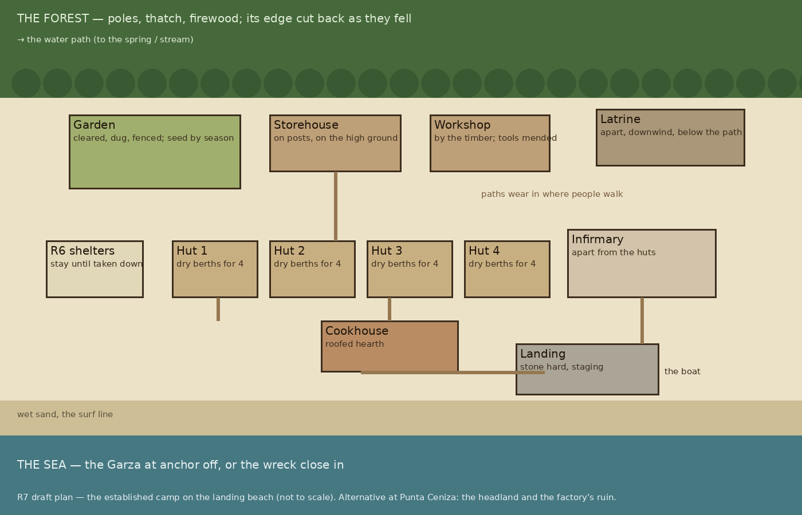
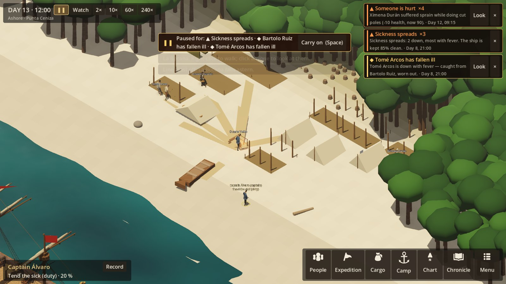
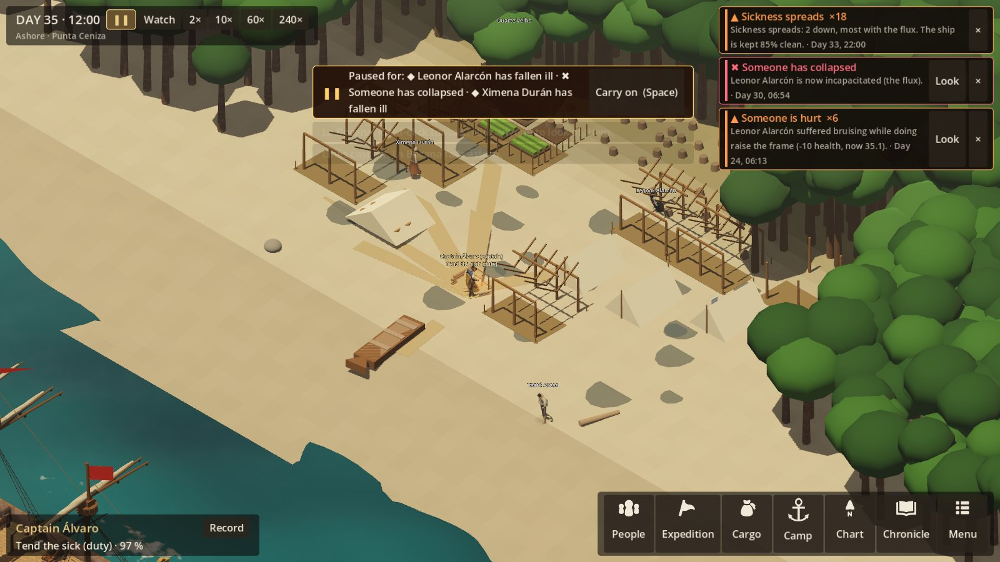
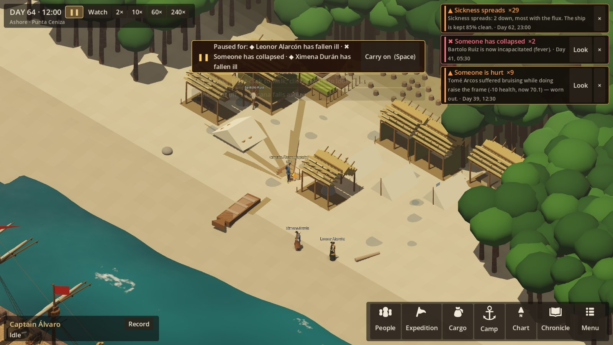
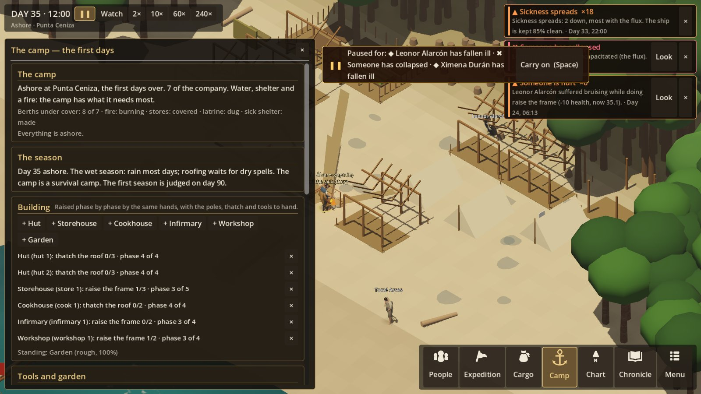
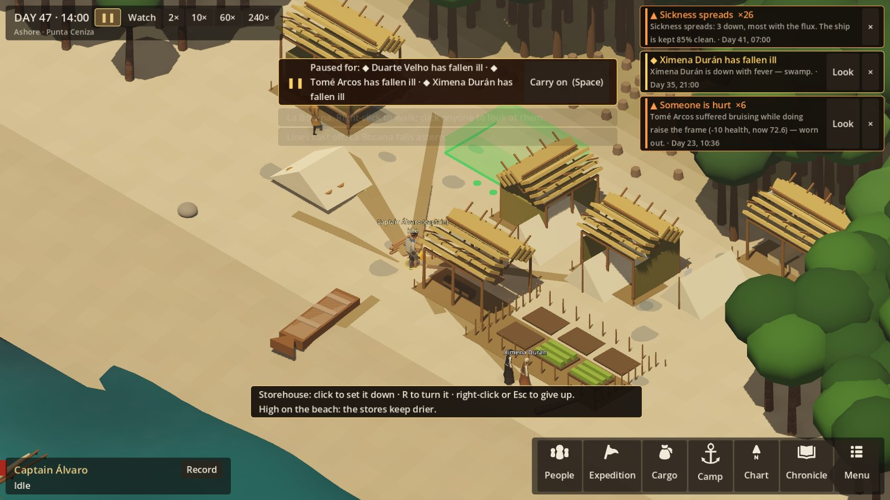
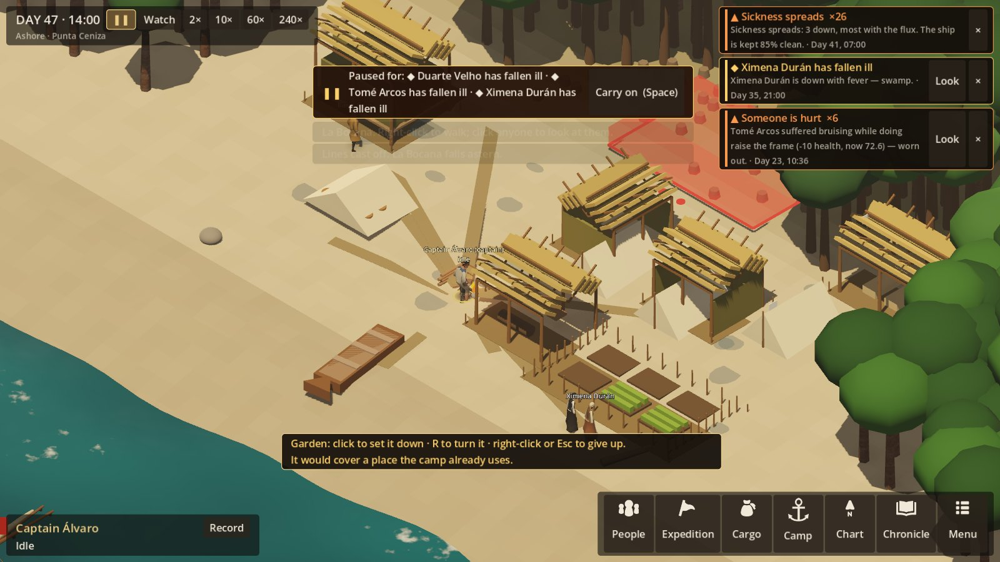
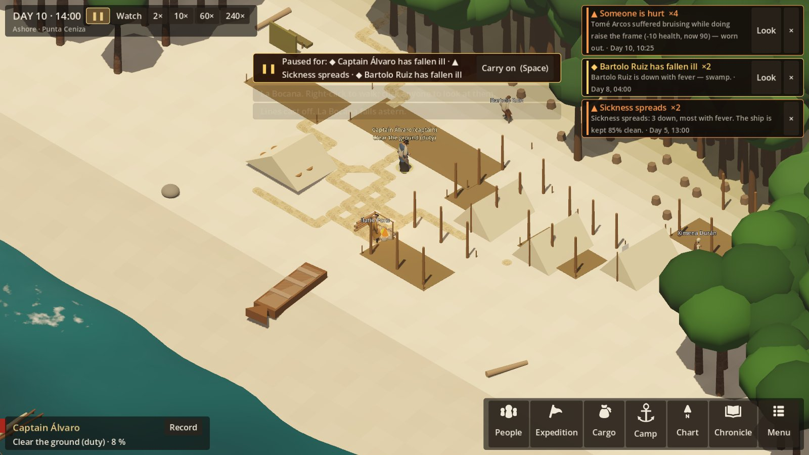
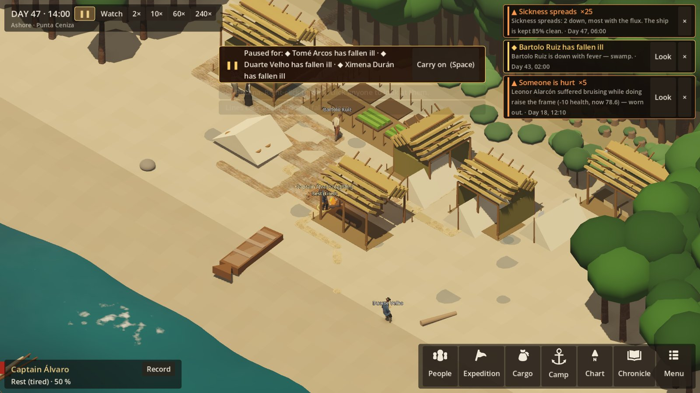
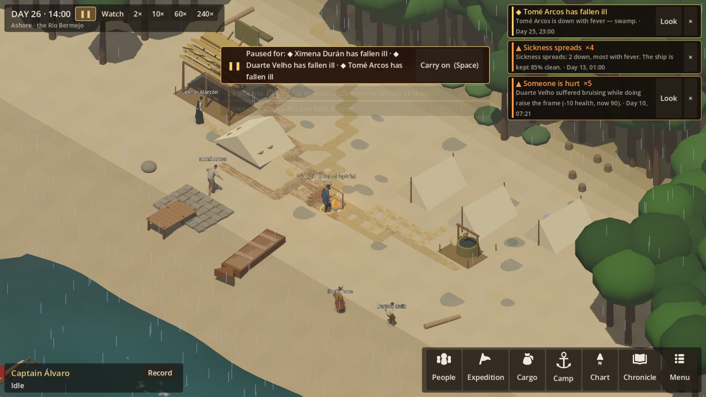

# R7 — Making the camp last

**Status:** first pass built (2026-10-22). The owner left the open questions to me ("You decide what
is next"); the decisions are under **Decided** below, and what was built under **As built** at the end.
**Authority:** SETTLEMENT_EXPERIENCE §7-19 (progression, construction, quality, the first buildings,
materials, tools, water, food, agriculture, storage, sanitation, health, work), §36-39 (seasons,
weather, change you can see), §50-54 (the vertical slice, the validation scenes, the build order).
SETTING §3, §5 (the factory, the Ember Coast's two seasons).

## What R7 is for

R6 got them through three days. R7 takes them through **their first wet season, about 90 days**, from
a camp of sail and brush to a place that can last. It ends when the first season is survived, or the
settlement fails. That is the first of the "two winters" the charter asks for (SETTING §3). Meeting
the coast's people is R8; R7 makes sure there is a settlement for them to meet.

The test of it (SETTLEMENT §2, §54): every building is made by the same people with the same tools and
materials, slowly, in the weather. The camp visibly changes as they do it.

## The pieces

### 1. Building, as work (§8, §9)

A **project** is a building on a plot. Each has:
- **phases:** clear the ground, set the posts, raise the frame, roof and walls, fit it out;
- **materials** for each phase;
- **tools** it needs, and those that help;
- **labour**, and the skill that helps;
- **weather:** no roofing in the rain.

Each phase is ordinary work on the task system, so tired, hurt or sick hands slow it.

**Quality** comes from three things:
- the skill of who did each phase;
- haste: the captain can order it hurried;
- fatigue.

Quality decides how well a building keeps out rain and stores, how long it lasts, and how much mending
it needs. A rough building is still a building.

**The first set** (§10, kept to these until the loop works):

| Building | What it does | Made of |
|---|---|---|
| **Hut** (×n) | Dry berths for four, for good: no chills, rest that restores | Poles, thatch, cord |
| **Storehouse** | Stores off the ground and dry: spoilage down sharply, no rain losses | Posts, planks or poles, thatch |
| **Cookhouse** | A roofed hearth: cooking in the rain, a fire that does not go out | Posts, thatch, stone |
| **Infirmary** | The sick laid apart and tended: less passing of sickness, better mending (it does not heal by itself) | Poles, thatch |
| **Workshop** | Where tools are mended and made, and timber is worked | Posts, thatch |
| **Garden** | Ground cleared, dug and fenced against animals; then planted | Labour, a spade, a fence of stakes |
| **Landing** | A hard of stones, and a timber staging | Stone, timber |
| **Well** | Only where the site allows it: water near and certain | Labour, stone, a spade |

The sail and brush shelters of R6 stay standing until they are taken down. Their cloth comes back
when they are.

### 2. Materials and tools (§11, §12)

**Materials gathered on the site:**
- **Poles and timber:** cut in the forest, with the axe.
- **Thatch:** palm and grass, cut by the cutlass or knife.
- **Cord:** bark or the ship's rope.
- **Stone:** from the point.
- **Firewood.**

Each source is finite near the camp. Felling clears the forest's edge, and that shows. The factory's
burned timbers at Punta Ceniza are a store of planks to be got.

**Tools are kept things.** Each wears with use, can be mended in the workshop, and can be lost or
broken:
- **Axe:** felling and building.
- **Saw:** planks.
- **Adze:** shaping.
- **Auger:** joints.
- **Spade and mattock:** digging.
- **Cutlass:** thatch.
- **Kettle, nets and lines.**

There are as many of each as were carried, and two hands cannot use one axe at once. *(Owner's call
below: what does the Garza carry?)*

### 3. Storage and spoilage over weeks (§16)

Spoilage moves from "each day at sea" to where things are kept:
- **In the open:** fast in the wet.
- **Under a sail:** slower.
- **In the storehouse:** slow, and set by its quality.

Damp, rats and weevils show in the stores' state. Seed stored badly does not sprout.

### 4. Water, for good (§13)

- **Carrying:** water is carried from the source found in R6. The labour shows as a daily duty, more
  as the camp grows.
- **Rain:** in the wet season, it can be caught off the roofs into casks.
- **A well:** only on a site that has the water for it. At Punta Ceniza the spring is near enough not
  to need one.
- **Fouling:** a latrine or animals too near the water foul it (§17).

### 5. Food over a season (§14, §15)

- **The ship's stores** run down, and the captain sees the day they run out.
- **Fishing and gathering** become regular duties, with nets and lines if they were carried.
- **The garden** is an experiment, not a promise (§15: "planting does not guarantee harvest"):
  - Each kind of seed has a planting window, a time to grow, and how well it takes in a wet tropical
    shore.
  - *Period-plausible, to be checked [RESEARCH]:* wheat and barley mostly fail in the heat and wet;
    onions, garlic and greens partly take; chickpeas and beans middling.
  - The crops that would truly thrive, such as cassava and maize, are the coast's own. They need the
    knowledge of its people, which comes with R8.

### 6. The seasons (§36, §37)

- **Two seasons:** wet and dry (SETTING §5). They land near the end of the dry. About three weeks in,
  the wet comes, with storms at the change.
- **The weather** reuses the voyage's machinery, adapted for land: rain spells, gales, still hot days.
- **What the wet does:**
  - rain most days, so outdoor work stops;
  - roofs leak by their quality;
  - fever from standing water;
  - the stream rises and muddies;
  - the garden drowns, or thrives.
- **One severe storm**, as the slice asks (§50):
  - shelters and roofs damaged by their quality;
  - stores wetted;
  - the ship, if she is at anchor, in danger at her moorings.

### 7. The stages, from what they can do (§7)

The camp's stage is named from what it has, not from points:
- **Landfall Camp:** R6.
- **Survival Camp:** reliable water, protected stores, sanitation and food coming in.
- **Established Outpost:** dry shelter for all, a workshop, an infirmary, a garden, a landing.

These are shown, not unlocked.

### 8. Work, without micromanaging (§19)

- **The captain's priorities** grow from R6's eight into the settlement's work:
  - building
  - gathering
  - water
  - cooking
  - the garden
  - fishing
  - the sick
  - mending
  - the watch
  - scouting
- **Projects:** a queue the captain orders. Hands take work by priority, their skills and the tools
  free.
- **Direct orders** still work as they do now.

### 9. What you see (§38, §39)

- Paths worn between the huts, the water and the landing.
- The forest's edge cut back.
- Buildings raised phase by phase: posts, then frame, then roof.
- The garden's rows, green or yellowing.
- The storehouse with its stores.
- Smoke from the cookhouse.
- In the wet: mud, puddles and the rain on the roofs.
- What was built first stays, or its traces do (§39 "preserve early structures").

## The plan (drawing above)

- **The huts** stand in a row above the high-water mark, behind them the cookhouse, and the storehouse
  on the higher ground.
- **The infirmary and the latrine** are apart, downwind, and away from the water path.
- **The garden** is cleared at the forest's edge.
- **The workshop** stands by the timber, and the landing by the boat.

At Punta Ceniza the alternative is the **headland**: the factory's site with its spring. It is better
drained and in plain sight from the sea. It is also where the garrison was lost, and maybe someone's
ground (owner's call below).

## How it would be built (order)

1. Plots and projects: the framework, phases, materials, tools, quality.
2. Materials gathered from the site, and the camp's map growing (cleared trees, paths).
3. Tools as kept things: wear, mending, the workshop.
4. The storehouse and spoilage by place.
5. Huts and the infirmary; health by where people sleep.
6. Seasons and land weather; the storm.
7. The garden.
8. The view: buildings by phase, the camp changing, the wet season.
9. The HUD: projects, the season, the stores' days, the stage.
10. Validation: "two weeks later" and "the first major crisis" (§51 B and C), staged and judged.

Saves move to a new format. Every step is tested like R6.

## Decided (2026-10-22)

1. **Tools.** The Garza carries a **carpenter's chest** as ship's stores: two axes, a saw, an adze, an
   auger, two spades, a mattock, two cutlasses, and nets and lines. Buying more in port comes later.
2. **Seed.** A small **seed chest** is carried by default: wheat, chickpeas, onions, cabbage. Buying it in
   port, with sellers' quality, comes later.
3. **Where.** They stay on the beach where they landed. The move to the headland waits for R8.
4. **How long.** The first season, **90 days**, ends in a judgement: the first season survived, or the
   settlement failed. Play goes on after it.
5. **The look.** Simple modelled shapes, as in R6. Meshy models come later, priced first.
6. **A palisade** waits for R8.
7. **Left for later in R7:** the landing staging and the well. A first pass builds huts, the storehouse,
   the cookhouse, the infirmary, the workshop and the garden.

## The questions as they were put

1. **What the Garza carries.** She sailed without axes or saws in her manifest. Either:
   - (a) she carries a **carpenter's chest and a few spades** as ship's stores, as any ship would; or
   - (b) the chandler at La Bocana sells them, and a captain who didn't buy them has a hard time.

   *(Recommended: (a) for the chest, (b) for extra tools and seed.)*
2. **Seed.** It isn't in her manifest either. Should it be bought in port, with a few kinds and
   quality as the sellers have it? Or carried by default?
3. **Where they settle at Punta Ceniza.** Stay on the beach, or offer the move to the headland and the
   factory's ruin? That move puts the question of whose ground it is (R8) at the centre. Elsewhere,
   they stay where they landed.
4. **How long R7 runs.** The first wet season, about 90 days, ending in a judgement: survived or failed.
   Or should it run open-ended until R8?
5. **The look of the buildings.** Simple modelled shapes like R6's, or proper models made with Meshy
   from your photos or reference sheets? Meshy credits would be quoted first.
6. **A palisade.** The old factory was a fortified post, and the charter wants one. Is that R7
   (building), or does it wait for R8 (whom it is against, and what that says)? *(Recommended: R8.)*

[RESEARCH] To check in the plausibility pass:
- Iberian ships' carpenters' kits around 1500;
- what seed went out with early expeditions, and how it fared on a tropical coast;
- pole-and-thatch building as sailors would have made it;
- the wet season's timing on this coast.

## As built (2026-10-22)

**Answering the owner's question** ("do buildings immediately get built or slowly, and do the visuals
follow each phase, or decay?"):
- **They are raised slowly.** Each building is a run of phases, each phase ordinary work done so many
  times by the same hands, with the poles, thatch and tools to hand. A hut is clear once, posts twice,
  frame twice, thatch three times. In the test runs a camp of six to seven raises the full set between
  about day 14 and day 50, through the start of the wet.
- **The view follows every phase:**
  - the ground cleared and pegged out;
  - posts going in one by one;
  - plates, rafters and then the ridge;
  - the thatch laid course by course from the eaves up;
  - fitted out: the storehouse's raised floor and door, the hut's brush walls, the infirmary's
    pallets, the workshop's bench, the cookhouse's hearth.
- **They decay.** Each building has a condition. The weather wears it daily, three times as fast in the
  wet and faster for rough work. The storm racks it, and a roof can come down. As it wears, the thatch
  darkens, thins to gaps and sags, rougher work sooner. The hands repair the worst roof in dry spells.

**Simulation** (`SimulationRunner.Settlement.cs`, `Shore/SettlementRules.cs`, `data/shore.json`
"settlement", `data/tasks/settlement.json`):
- **Projects** on ground the captain chooses (see Placing buildings). Each phase task works only at a
  building at that phase. Quality comes from the
  hand's skill and freshness. Materials laid by work that was stopped wait on the plot for the next
  start.
- **The forest's edge:** poles and thatch, finite near the camp, then far less.
- **Tools** (the carpenter's chest of 3 axes, 2 adzes, a saw, an auger, 2 spades, a mattock and 3
  cutlasses; nets; the seed chest):
  - Two hands cannot use one tool.
  - They break (0.2% an hour of use).
  - They are mended at the hearth (60% of the usual chance) or the workshop.
- **The buildings:**
  - **Huts:** dry berths for four.
  - **Storehouse:** spoilage by place, as well as it was made.
  - **Cookhouse:** a fire kept.
  - **Infirmary:** a quarter better care, 30% less contagion.
  - **Workshop:** mending at the bench.
  - **Garden:** six beds.
- **The season:**
  - The wet from day 20, rain four times as often.
  - The storm on day 30, 30 hours. It finds out bad work, blows down the R6 shelters, and works the
    ship at her cables.
- **The garden** [RESEARCH]:
  - wheat and chickpeas rot in the wet;
  - greens and onions may give something if tended.
- **The stage** is named from what the camp can do.
- **The first season** is judged on day 90: survived if more than half are alive, there is water, dry
  roofs for all, and food for a fortnight or a source of it.
- **Saves:** format 38 (39 with placing).
- **Tests:** `SettlementTests` (11, then 15 with placing).

**The camp screen:**
- the season and the stage;
- building orders;
- each work in hand, with its phase, its progress and what it wants;
- what stands, with its quality and condition;
- the tools, broken ones included;
- the materials;
- the garden's beds.

The day-90 card gives the judgement.

**Developer flags:**
- `--build=all` (or `hut,storehouse,...`) orders buildings after the first three days; use it with
  `--ashore --camphours=N`. `hut@12:13` sets one down with its middle at that cell, `hut@12:13t` turned.
- `--ghost=storehouse@20:15` shows a building being set down there, outline and notice, for screenshots.

### Placing buildings (2026-10-22, owner: "yes build it")

The fixed plots are gone. The captain chooses where each building goes:
- **Placing:** "+ Hut" (or any building) on the camp screen closes the screen. An outline of the
  building's ground follows the mouse over the beach, green where it may go, red where it may not, with
  its two work places marked at its front (the sea side). A notice at the foot of the screen says what
  is wrong there, or what the ground will mean. Left-click sets it down; R turns it a quarter;
  right-click or Esc gives up.
- **Where it may not go:**
  - the wet sand (rows 2 and below);
  - rocks and driftwood;
  - over another building, or its work places;
  - over a place the camp already uses (the hearth, the stores, the shelters, the latrine, the cutting
    places);
  - where it would shut the way from the hearth to the water, the landing, a place the camp uses or
    another building's front (people walk round buildings; see below);
  - where its front is not open ground the hands can reach.
- **Trees** on the ground are allowed. They are felled in the clearing: a third more clearing work for
  each three trees (rounded up), and two poles for each tree when the clearing is done. The forest's
  trees on that ground are drawn felled while it is cleared, and gone after.
- **Where it stands matters:**
  - **Storehouse:** high on the beach (row 13 up) the stores spoil at 0.85 of the rate; low and damp
    (row 8 down), at 1.3.
  - **Infirmary:** within 6 cells of a hut it cuts contagion only to 0.9, not 0.7.
  - **Garden:** at the forest's edge (row 15 up) the crops waste at 0.8 of the rate from the soil; on
    the open sand (row 10 down), at 1.25.
  - **Hut:** more than 14 cells from the hearth, a note: a long walk from the fire.
- **Ordering without a place** (old code, `--build`, tests): the old plots first where free, then the
  best ground for it, with the fewest trees, nearest the hearth.
- **Saves:** format 39. Each building and work in hand has a position, whether it is turned, and its
  trees. Older saves' fixed plots become the places those plots stood.
- **Tests:** `SettlementTests` gained the rules (`BuildingsGoWhereTheGroundAllows`), the ground filling
  up, trees felled for poles, siting effects (`WhereItStandsMatters`) and the old-plots migration;
  553 in all.
- **Balance:** the 90-day probe at Punta Ceniza and Río Bermejo still survives the first season, the
  full set up by about day 40 to 44.
- **Watch:** the mid-beach fills fast once two huts are down, because of the shelters' places. It is
  enough for a camp of six to ten. If it feels cramped, the R6 shelters' places can be freed once huts
  stand.

### Paths worn by feet, and the vegetation growing back (2026-10-22, owner's ask)

The owner asked that paths appear only as people walk them, and that what is cut or cleared grow back
when left alone. Both are now in the simulation, and the view only draws them.
- **People walk round buildings**, not through them, once the posts are in. Whoever is inside a
  building's ground when it goes up walks out of it.
- **Routes in the open cut corners**: of the shortest ways round what is in the way, people take the one
  nearest the straight line (`Pathfinder.FindNaturalPath`), so the tracks run on the slant.
- **Wear:** every walk across the camp treads each cell it passes once. So do the day's comings and
  goings that the work does not walk out step by step: each person on their feet goes each day from
  where they sleep (huts, else the shelters, else the fire) to the fire and back, to the stores, to the
  latrine once dug, and to the water once found. The ground takes back 4% of a cell's wear a day while it
  is walked, and 12% once no one has walked it for 5 days.
- **Seen:** a cell shows once walked about 40 times (net of fading). It is worn bare at 400. The worn
  cells are joined into tracks, darker and wider the more they are used. In the 90-day runs the main
  ways show within 3 to 6 days and are worn in by day 10. Nothing is drawn where no one goes.
- **Growing back** (`ground` in `data/shore.json`; days of being left alone):
  - **A felled tree** (one for every 4 poles cut, the standing tree nearest the cutter): a stump, scrub
    from day 8, brush from day 20, a sapling from day 40, and a tree again at day 75. Then it counts
    again in what the forest's edge can give (4 poles back). Cutting within 2 cells keeps the felled
    places round it open.
  - **Ground given up** (a building abandoned after clearing, or blown down): bare earth, scrub from day
    8, back to what it was at day 20. Its trees grow back as above.
  - **Trodden ground** does not grow back while walked. Ground built on again is kept clear.
  - **Thatch** grows back 3 bundles a day once none has been cut for 10 days.
  - [RESEARCH] Pioneer growth on a wet tropical shore is fast; the days are a reading for play.
- **Saves:** format 40, with each worn cell, each cell growing back, and when thatch was last cut.
- **Tests:** a building may not shut the way from the hearth; people walk round buildings; paths are worn
  only where feet go; paths fade when left alone; a felled tree grows back stage by stage; ground given
  up grows back. 559 in all.
- **Balance:** unchanged. The 90-day runs at Punta Ceniza and Río Bermejo survive the season, with the
  buildings up by about day 44.

**Not yet:**
- The landing staging and the well.
- The factory's timbers.
- Buying tools and seed in port.
- Moving to the headland (R8).
- A palisade (R8).
- Proper models for the buildings: Meshy, priced first.
- A sound bed for the settlement: saws, axes, the wet.
- Sickness runs high in the wet at Punta Ceniza, from the swamp fever and the flux passed in the
  crowded shelters. It is plausible, but is to be watched in balance.

### The rest of R7 (2026-10-22, owner: "r7 and r8 go")

- **Stone** (`item.stone`): gathered on the beach's rocks (two places to work at, `spot.stone_1`, `spot.stone_2`),
  90 loads where the site has rock. There is none at the Bajos Largos or the Manglares.
- **Planks:**
  - **The factory's timbers:** at Punta Ceniza, once the burned factory is found, its sound timbers are salvaged
    from the headland (`spot.headland`, at the right of the camp): 30 planks in all.
  - **The pit saw:** elsewhere, or once the ruin is stripped, planks are sawn from poles at the workshop: 3 poles
    make 2 planks. Poles are cut for the saw as for anything else.
  - The ship's own oak planks are used first.
- **The well** (2×2): cleared, dug four times, lined twice with poles and wattle. Only where the site has water to
  dig for: none at Punta Ceniza (rock, and the spring is near) or Punta Falsa. Sweet at the Río Bermejo, the Bajos
  Largos and elsewhere; brackish at the Manglares. It is a water source two steps from the camp, and water is drawn
  at it. Within six cells of the latrine it is fouled: brackish, with the flux that brings. The placing notice says
  so.
- **The landing** (4×3): stones laid three times (6 a time), then a planked staging twice (3 planks a time, with
  the auger). It must run down to the wet sand, the only building that may. Its work places are at its head on the
  dry sand. People walk over it. With a landing, the boat brings half as much again each trip. An established
  outpost now needs one, where there is a boat.
- **Only roofed buildings** are worn by the weather and the storm; a well, a landing and a garden are not.
- **The chandler** at La Bocana sells the carpenter's tools (axe, saw, adze, auger, spade, mattock, cutlass), a
  seine net, and seed (wheat, chickpeas, onion, cabbage). Bought, they sail in her hold and are landed with the
  stores.
- **The camp heard** (`CampSound`), from the recorded samples already in the game (Kenney, Freesound; all CC0):
  - the surf and the wind, louder in a storm, and the rain;
  - the work going on, each kind at its own pace, more with more hands: axes, mallets on posts and frames, the saw,
    thatch cut and laid, stone shifted, spades, a tool mended;
  - the work falls quiet above 10× speed and when paused.
- **Tests:** the well only where there is water; the landing at the water's edge, and the boat landing more; a
  landing raised with stone gathered and planks sawn; the factory's timbers salvaged; the chandler's tools and
  seed. 564 in all.

**Building models (Meshy/Rodin): not made, priced only.** The repo's rule is no AI concept images: each model needs
a free photo with a clear background from you, uploaded at no cost. Hyper3D Rodin Fast was 300 credits a model.
Expedition has 1,755 of its 4,125 credits left this month, so at most five. A photo brief, best first:
1. **Hut:** a pole-and-thatch hut on posts, steep palm-thatch roof to the eaves, open or wattle sides; 3/4 view.
2. **Storehouse:** the same, raised on posts off the ground, planked floor and a door; 3/4 view.
3. **Well:** a wattle-lined well with a low curb, two posts and a beam with a bucket; side view.
4. **Landing:** a short timber jetty on posts over a stone hard at the water's edge; 3/4 view from the land.
5. **Workshop:** an open-sided thatched shed with a bench and a saw pit beside it.
