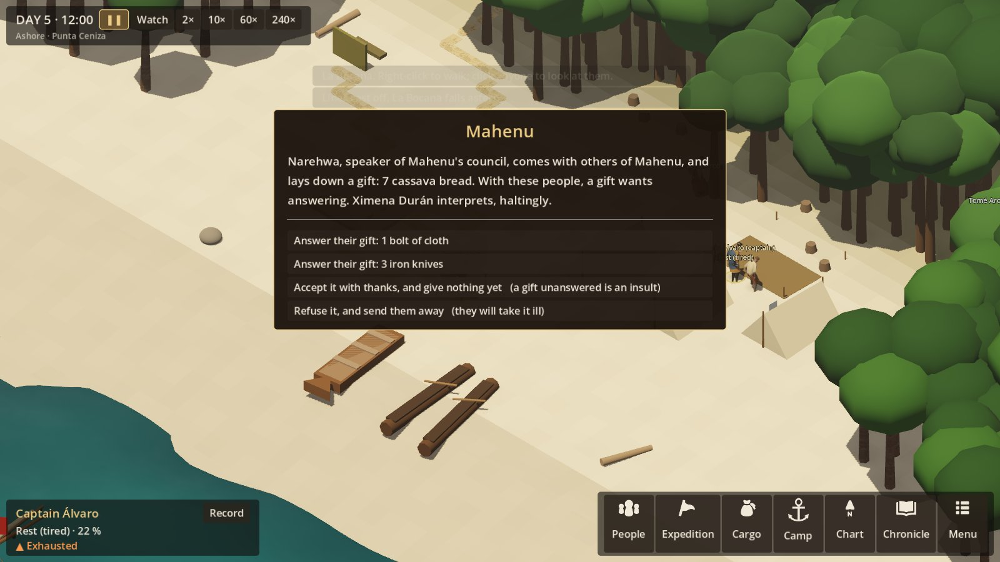
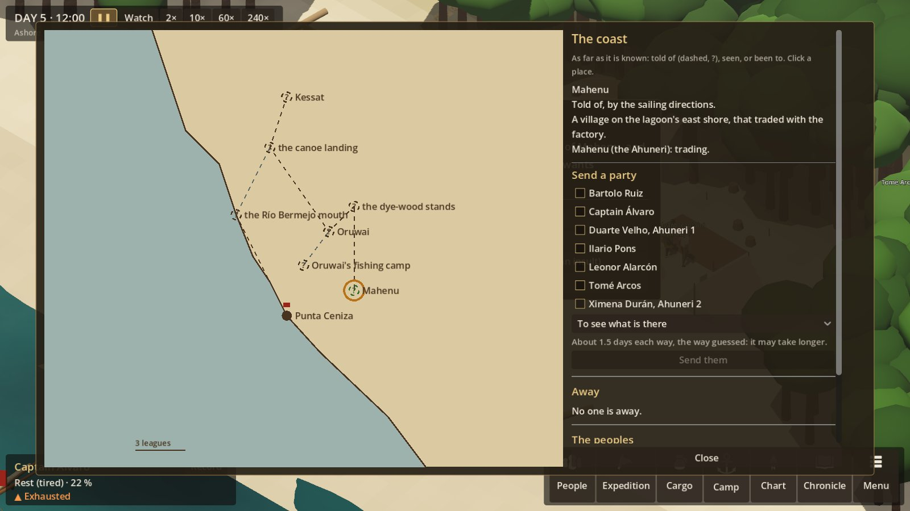
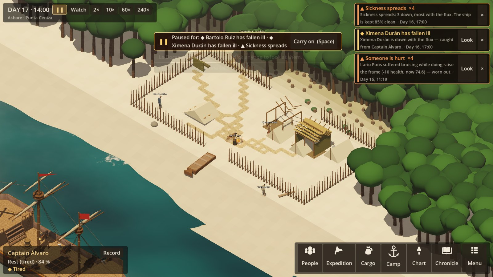
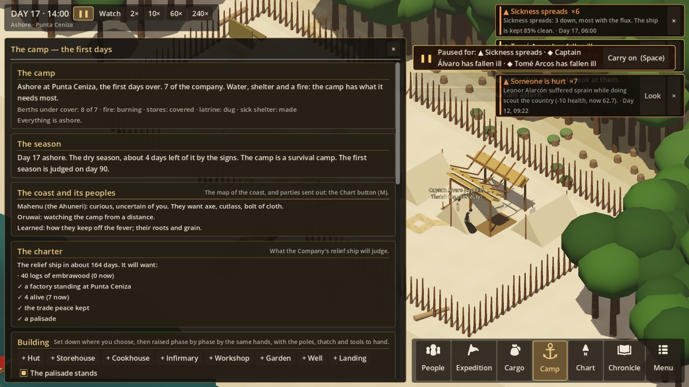

# R8 — The world around the camp

**Status:** first pass, built 2026-10-22. The owner said "r7 and r8 go". The decisions below were mine to
make; each is marked **Decided** and can be changed.

**Sources:**
- SETTLEMENT_EXPERIENCE §26–35: exploration, the regional map, the communities, language, trade,
  knowledge, other Europeans, the sponsor, communication delay.
- SETTING §3 and §5: the charter, the Ahuneri and the Tesiwa, the Brennish.
- ART_BIBLE §7.5 and D-012: each people is a coherent culture of its own, with agency and no caricature.
- The port's people: Ximena lived at Mahenu and has a son there. Velho saw the Santa Clara's master
  hang Ahuneri pilots.

## What R8 is for

R7 made the camp last a season. R8 puts it in a world that was there before it:
- **Peoples who were here first** and who are not the same people as each other.
- **Ground that is someone's.**
- **Knowledge that only they have**, which matters more than anything in the hold.
- **The Company's charter**, which wants wood, a fort and a garrison. It wants them by a date, from
  people who cannot get the wood alone.

The rule from SETTLEMENT §28 runs through all of it: don't assume hostility, don't assume friendship,
and don't treat land as unowned because the newcomers don't know whose it is.

## The pieces

### 1. The regional map (§26, §27)

`data/region.json` holds the Ember Coast around the great lagoon, with places and routes in leagues.
**Everything on it exists whether or not anyone has found it** (fog of knowledge, not fog of
existence). For each place, the expedition's knowledge is one of:
- **unknown:** not drawn;
- **reported:** told of, perhaps wrongly, and by whom;
- **seen:** from a distance or from the sea;
- **visited:** been there and seen what it is.

Routes are known once walked or told of.

**The places:**

| Place | What it is |
|---|---|
| Punta Ceniza | The headland and the burned factory |
| The lagoon shore | Mahenu's and Oruwai's fish weirs |
| Mahenu | An Ahuneri village of long houses in a ring, on the east shore |
| Oruwai | An Ahuneri village at the north end, by the dye-wood |
| The dye-wood stands | Embrawood, cut by Oruwai's and Mahenu's households, by leave |
| Oruwai's fishing camp | Where the garrison took people |
| The Río Bermejo mouth | |
| The Tesiwa canoe landing | Up the river |
| Kessat | The Tesiwa town in the valley |
| The hill | The Tesiwa lineage's sacred ground: not to be entered |
| The salt pans | |
| The Brennish cove | Where interlopers' ships put in |
| The other landing sites | Bajos Largos, Punta Falsa, the Manglares |

Wherever the camp is, its site is on the map. The Company's sailing directions give Punta Ceniza,
Mahenu (from Ximena's tale and Velho's) and the river. Everything else must be found or told.

### 2. Journeys (§26)

A party of one to four sets out to a known or reported place:
- **Packing:** they take food and water from the stores for the days there and back, and eat only what
  they carried.
- **The way:** they go by the routes known. A route not known is guessed: half as long again, and a
  chance of getting lost.
- **A guide** (someone with tracking) or **an Ahuneri speaker** shortens it.
- **Arriving:** they find the place and the ways on from it. Arriving at a people's village unasked is
  a meeting on their ground, and goes by how that people stands to the newcomers.
- **Coming back:** they report, and the map fills in. On the way they may be hurt or fall sick.
- **While away** they do no camp work and are not drawn.

### 3. The peoples (§28)

**Decided:** in this pass there are **three communities**, Mahenu, Oruwai and the Tesiwa at Kessat.
Each has:
- **Its own standing toward the newcomers:**
  - trust, built by fair dealing, gifts answered, promises kept and help given;
  - grievance, built by the opposite, and by using their ground and wood without leave.
- **A stance** that follows from those and from its temperament:
  - **watching:** not yet met;
  - **curious;**
  - **trading;**
  - **wary;**
  - **avoiding;**
  - **hostile:** only from grievance, and never as a default.
- **Wants:** iron tools, cloth, hooks; allies; and things that cannot be traded (their forest
  respected; no one taken).
- **What it has:** cassava bread, maize, smoked fish, fruit, cotton cord, embrawood logs, salt and
  stone blades (Tesiwa).
- **Named people,** each with a role and a view of their own:

| Community | Who | Their view |
|---|---|---|
| Mahenu | **Narehwa**, the council's speaker | For renewed trade, and against the old garrison's ways |
| Mahenu | **Ahiro** | Ximena's son |
| Oruwai | **Hiruwe**, speaker | For keeping the newcomers weak and at a distance |
| Oruwai | **Wenari** | A canoe-builder who trades whatever the council says |
| Kessat | **Sattek**, war captain for the season | Proud, and wants the trade for the river |
| Kessat | **Kuusit** | Keeper of the hill |
| Kessat | **Teskaat** | A trader who deals with the Brennish |

**They act on their own,** once a day, by their stance and their interests:
- **They watch:** canoes off the point, smoke on the far shore.
- **They come to the camp:** a delegation with a gift, goods to trade, a question or a request.
  Mahenu asks for iron, and for help if the Tesiwa press them. Oruwai asks whether the strangers mean
  to cut the wood. Teskaat comes quietly to trade past the Ahuneri.
- **They test:** a tool goes missing in the night.
- **They stay away:** the weir is closed to the camp's foragers.
- **They warn.**

Neither people is the hostile one or the friendly one: Oruwai's caution has a reason, and Mahenu's
welcome has terms.

**Decided:** in this pass the peoples' named persons are characters of the data, not full simulated
characters. They have no needs or schedules. Making them persistent characters (relationships,
knowledge, history) waits for a later pass, as SETTING allows.

### 4. Language (§29)

At each meeting, how well the camp can speak with the visitors decides how much goes wrong:
- **Who interprets:** the best speaker at the camp. Ahuneri for Mahenu and Oruwai. Tesiwa for Kessat,
  or Ahuneri a level worse, which their traders speak as the lagoon's trade tongue.
- **The chance of a misunderstanding** on anything said:

  | Interpreter's level | Chance |
  |---|---|
  | None | 35% |
  | Limited (1–2) | 18% |
  | Functional (3) | 7% |
  | Fluent (4–5) | 2% |

- **What a misunderstanding does:** a gift taken as payment, a question not answered, a request agreed
  to without knowing it. It costs a little trust, never the visitors' dignity: they are not made
  ridiculous.
- **Learning:** each meeting, the best speaker under functional has a small chance of getting better.
  Ximena (Ahuneri 4) is the interpreter if she sailed.

### 5. Trade (§30)

Trade is goods and relationship together, and value depends on who is trading:
- **What things are worth** depends on who wants them and how much they already have. An axe is worth
  more at Oruwai, which has the wood, than at Kessat, which has stone and Brennish iron.
- **Offers:** each delegation offers two or three exchanges at its own valuation. Accepting a fair one
  builds trust. Declining is no offence.
- **Gifts (Ahuneri):** a gift opens a meeting, and a gift unanswered by the next meeting is an insult.
- **The Company's trade chest** comes ashore with the ship's chest: iron knives, bolts of cloth,
  fishhooks. These are what the factory traded.

### 6. Knowledge (§31)

Knowledge is told by a people who trust the camp enough, through an interpreter good enough. Each
piece does something:
- **Fever lore** (Mahenu): sleep up off the ground, in smoke, away from standing water. The swamp fever
  ashore falls by 40%.
- **Their roots and grain** (Mahenu, Oruwai):
  - cassava and maize become garden crops, with cuttings and seed given or traded;
  - they suit the shore as the seed chest's never will.
- **Bitter cassava** (Mahenu): grated, pressed and dried, it is food. Without knowing it, the roots
  sicken whoever eats them.
- **The storm at the change of season** (Oruwai, Mahenu): warned of in advance. Roofs made fast take
  40% less damage.
- **Routes:** the river to Kessat (the Tesiwa, or Mahenu); the way to the dye-wood.
- **Who trades with whom:** the Tesiwa trade with the Brennish at the cove.
- **What happened to the garrison**, told differently by each:
  - **Oruwai:** "They took our people from the fishing camp to make us cut wood. We burned their
    house."
  - **Kessat:** a boast that their Brennish iron did it.
  - **Mahenu:** given only to those they trust most, through a good interpreter. Narehwa sheltered two
    of the garrison who fled, against Oruwai's anger. One of them, **Gaspar Lezo**, lives at Mahenu
    still.

### 7. Embrawood and the charter (§33)

**The charter**, as SETTING §3 sets it out (**Decided** for this pass):
- **The relief ship** comes on **day 180** after landing.
- **It expects:**
  - **40 logs** of embrawood;
  - **a factory standing:** a survival camp or better, at the place the Company sent them;
  - **a palisade;**
  - **at least half of those who landed alive** (no fewer than 4);
  - **the trade peace kept:** no one seized, and no raiding.
- **Logs** come by trade (the Ahuneri bring them by canoe) or by sending a party to cut them:
  - with leave, that is the custom;
  - without leave, Oruwai's grievance climbs, and Mahenu's a little.
- **Selling logs to the Brennish** breaks the charter.
- **The judgement:** the charter kept, kept in part, or revoked. Play goes on after it.

**Communication delay (§34):** a letter can go home only with a passing ship. One given to the
Brennish reaches the Company months later. If it does, the relief ship comes better found: more stores
and a few more hands. Nothing arrives sooner than a ship could bring it.

### 8. The Brennish (§32)

**Decided:**
- A Brennish trader, the **Merle**, puts in at the cove around **day 50** for about 12 days.
- **The Tesiwa:** she trades with them. Teskaat's iron comes from her, and Kessat cares less for the
  camp's axes while she is there.
- **She sends a boat to the camp,** with:
  - wine, biscuit and iron for sale, at a price;
  - news;
  - an offer to carry a letter;
  - an offer to buy embrawood, which breaks the charter.
- **Warning her off,** in the Company's name, is allowed. She takes it badly, and Kessat hears of it.
- **A hand** stressed to breaking point may slip away to her.

### 9. The palisade (R7's question)

**Decided:** the palisade is R8's, because whom it stands against is the question.
- **The work:** a ring of stakes round the camp, raised as camp work (poles and axes). The charter
  wants it.
- **Mahenu reads it as distrust** (some trust lost), unless the captain explains it at a meeting.
- **Oruwai shrugs:** strangers fear what they have done.
- **Kessat reads it as strength:** less testing.
- **Theft at night** is much less likely with it, and with a watch kept.

### 10. Violence

**Decided:**
- **One grave choice:** after a theft, the captain can hold the next canoe's people until the tool is
  returned, as the garrison did. It breaks the trade peace and the charter. Oruwai and Mahenu remember
  it, and the stance it brings is earned.
- **Nothing in this pass makes violence the easy way.**

### 11. The headland (R7's question)

**Decided:** the question is asked and answered in R8. Mahenu and Oruwai both say the headland's ground
is Oruwai's fishing households'.
- **Asking leave** (a meeting choice at Oruwai, with enough trust and gifts) can win it.
- **Building there without leave** is a grievance, every day.
- **The physical move** of the camp to the headland, its own map with the ruin and the spring, waits
  for a later pass. What R8 records is whether leave was given.

## What you see

- **A regional map** (the Chart button, ashore):
  - places drawn by how well they are known: reported ones dashed, with a "?";
  - routes known and guessed;
  - parties on the way;
  - each people's villages with their stance.
- **Choosing a place** shows what is known of it, and from whom. From there a party is sent, with the
  people chosen and its purpose: explore, visit, or cut wood.
- **The Camp screen** gains:
  - **the peoples:** stance, trust in words, what they want as far as is known, and what is owed;
  - **what has been learned;**
  - **the charter:** logs, days to the relief ship, what it will judge;
  - **a palisade order.**
- **Meetings** come up as decisions, as events do at sea: gifts, trades, questions, leave asked,
  sending them off.
- **The palisade** stands round the camp as it is raised.

## Not in this pass

- The peoples' persons as full characters.
- The move to the headland.
- A second European expedition.
- The Tesiwa's own wars and alliances played out off the map.
- Proper models and sound for the peoples.

[RESEARCH] All of the peoples' culture here is invented for a fictional world, but it is to be checked in
the plausibility pass, against what is known of coastal and riverine peoples of the period. That covers:
- cassava processing;
- fish weirs;
- council and speaker;
- gift exchange;
- canoe trade;
- the Brennish dye-wood trade's history on such coasts.

## As built (2026-10-22)

**Simulation** (`SimulationRunner.World.cs`, `Shore/RegionRules.cs`, `Shore/WorldState.cs`, `data/region.json`):
- **The coast:** 15 places and 17 routes, each known as unknown, reported, seen or visited, with who said
  so. On landing, the sailing directions give Punta Ceniza, Mahenu and the river.
- **The peoples act at first light each day:**
  - their ground used without leave is a slow grievance once they have met the newcomers;
  - a gift left unanswered for eight days is an insult;
  - grievance fades slowly;
  - before they first come, they watch the camp from the water;
  - a people that is wary or worse may steal a tool in the night (a palisade cuts that sharply);
  - otherwise the first people whose time has come sends a delegation, the Ahuneri with a gift.
- **Meetings** stop the clock like events, through the best interpreter at the camp:
  - **the gift:** answered with trade goods first, accepted with nothing given yet, or refused;
  - **business, as many rounds as the captain likes:**
    - up to three trades at their own valuation (fairer as they trust the camp; less for what they
      already have plenty of);
    - questions about what they know;
    - leave to cut the red wood or to stay on their ground;
    - the palisade explained;
    - a stolen tool asked back;
  - **misunderstandings** by interpreter level, each with its own cost;
  - **learning:** the best speaker short of functional may improve a level.
- **Knowledge:** eleven topics with real effects:
  - fever lore cuts the swamp fever by 40%;
  - their roots and grain make cassava and maize garden crops, with cuttings and seed given;
  - bitter cassava is safe once learned (`safeWith` on the item's sickness);
  - the storm warning cuts storm damage by 40%;
  - three topics reveal routes and places;
  - three tellings of the garrison's fate.
- **Journeys:**
  - a party of one to four, packed with about three rations a day from the stores;
  - routes not known cost half as much again, with a chance of getting lost;
  - a guide (tracking 2+ or Ahuneri 2+) is quicker;
  - on the road they eat only what they carry, and may turn an ankle or catch a fever;
  - arriving, the way there is known, the places beyond are seen, and the people there take them in
    or turn them back, by their stance;
  - **Ximena at Mahenu** finds her son;
  - **the hill** is a grave offence to Kessat;
  - **the dye-wood** without leave is Oruwai's grievance.
- **The Brennish** come on day 50: the boat's visit, buying, selling logs (against the charter), a
  letter for the Company, warning them off (Kessat hears). When the ship leaves, someone stressed to
  breaking may go with her.
- **The charter** is judged on day 180:
  - **its terms:** logs, the factory at Punta Ceniza, half alive, the trade peace, a palisade;
  - **the verdict:** kept, in part, or revoked;
  - **a letter home** sent by day 120 makes the relief ship better found.
- **The trade peace** breaks if the captain holds a canoe's people over a theft, or sells logs to the
  Brennish.
- **The palisade:**
  - it is camp work, ten rounds of six poles;
  - Mahenu sees it at 30% and loses some trust, unless it is explained;
  - Kessat gains some respect for it.
- **The Company's trade chest** comes ashore: 40 knives, 12 bolts of cloth, 300 hooks.
- **Saves:** format 41.
- **Tests:** `WorldTests` (12). 576 in all.

**The game:**
- **The Chart button ashore** opens `RegionView`: the coast drawn as known, routes, parties on the way,
  the villages coloured by stance. Choosing a place shows what is known, from whom, and whose ground it
  is. From there a party is sent: who, why, and the days it will take.
- **Meetings** use the event window. While a delegation is at the camp, their dugouts lie on the beach.
- **The Camp screen:**
  - the coast and its peoples (stance, trust, wants, what is owed, what has been learned);
  - the charter's terms ticked off;
  - the palisade order.
- **The palisade** is drawn round the camp, stakes set from the gate both ways.
- **Developer flags:**
  - `--meeting=people.mahenu` (or `none`);
  - `--learn=know.roots,...`;
  - `--trust=people.mahenu:30`;
  - `--chart --mapselect=place.mahenu`;
  - `--build=palisade`.

**What I noticed:**
- **Ximena** claims Ahuneri 4 in port, and is 2 in truth, so she interprets "haltingly". That is the
  port's hidden-quality system working as meant: worth knowing before relying on her.
- **Sickness** at Punta Ceniza is still the camp's worst trouble. The fever lore helps, if Mahenu is
  trusted enough to tell it.

**Done since** (the full arc, `docs/SETTLEMENT_VALIDATION.md`):
- **A full playthrough to day 180** by a careful test captain, on three seeds: the charter kept on all
  three. The faults it found are fixed there.
- **The relief ship's arrival** has its card in the game.
- **Gaspar Lezo** can be met at Mahenu and brought to the camp (§12 below).
- **Meetings end:** a question or a request for leave refused is not pressed again at the same meeting,
  and visitors go home of themselves after sixteen exchanges.
- **Leave for the wood** is asked only of the people whose wood it is (Oruwai), not of Mahenu.
- **Tools:** a tool is offered in trade or as a gift only while the camp keeps two of it, and a trade
  of tools says how many will be left.

### 12. Gaspar Lezo, the garrison's survivor

Once Mahenu has told what happened to the garrison (trust 42, an interpreter at 3), a party that goes
to Mahenu meets him. He comes down to the camp after the party is home, and the captain may:
- **ask him how the factory fell:** the commander kept Oruwai's young men in the stockade at night to
  cut wood, and Oruwai and Kessat came for him at the new moon;
- **ask him to join:** he is one of the camp from then on, an interpreter at 4, a forager and
  fisherman. Oruwai holds the garrison against him: their trust falls by 6, their grievance rises by 10;
- **leave him to Mahenu:** Mahenu is glad of it. A later party to Mahenu may ask him again.

Taking him in early can cost the wood: in the test run he joined on day 19, and Oruwai never trusted the
camp enough again to give leave to cut. The test captain now asks him once the wood is secured.
`--meeting=survivor` stages his visit for a screenshot.
