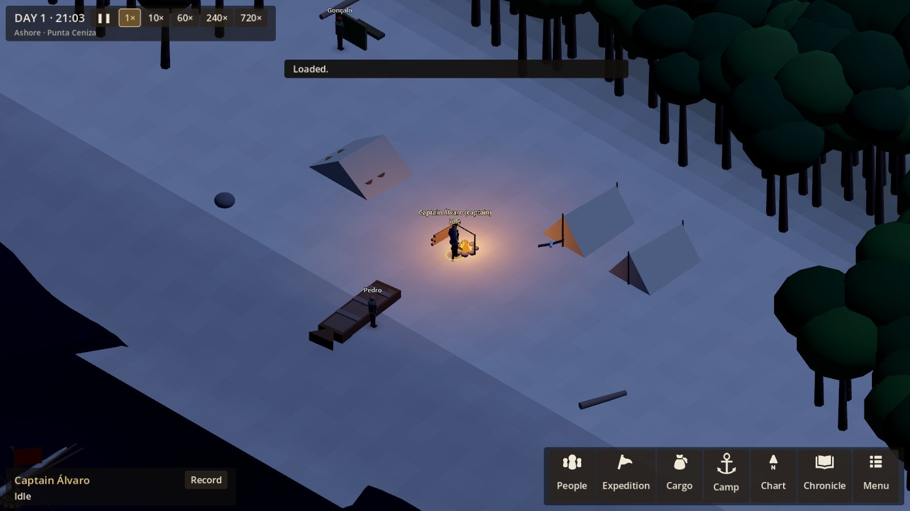
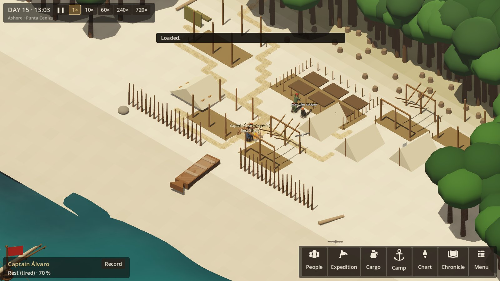
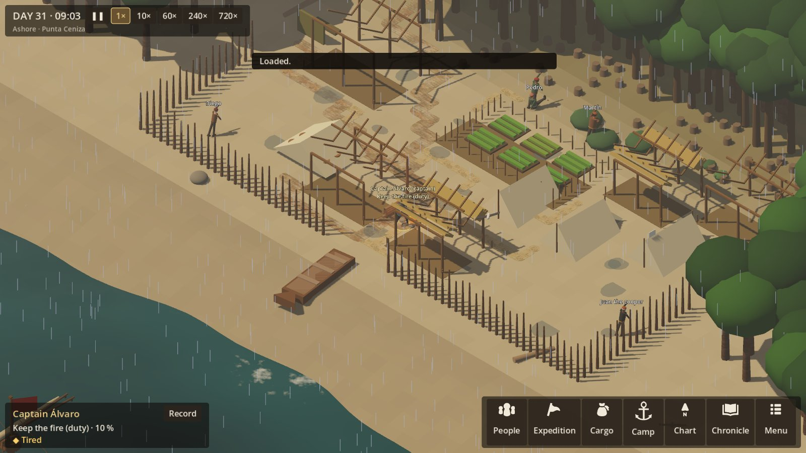
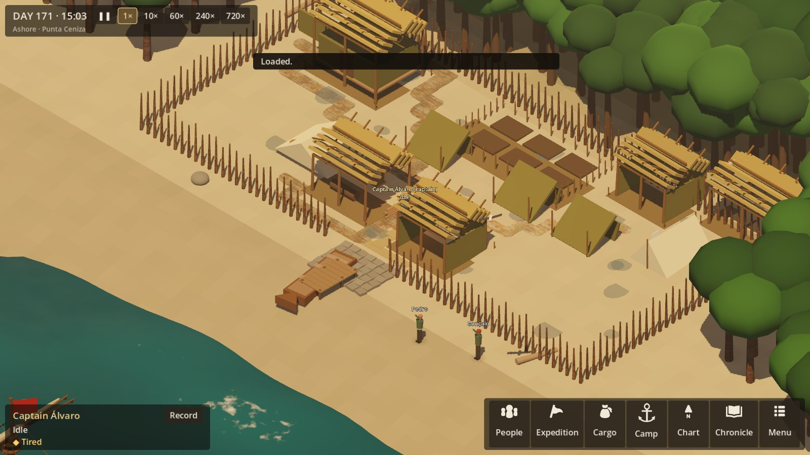
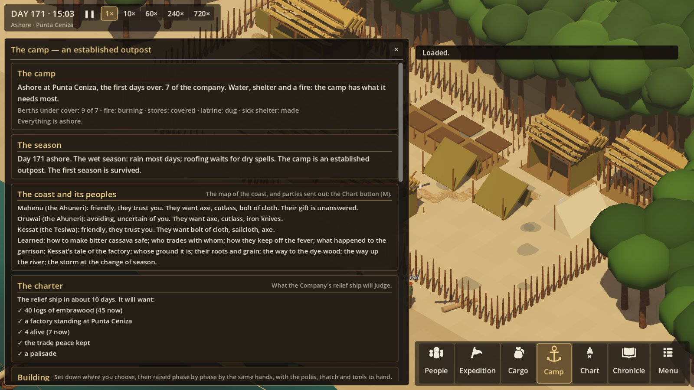
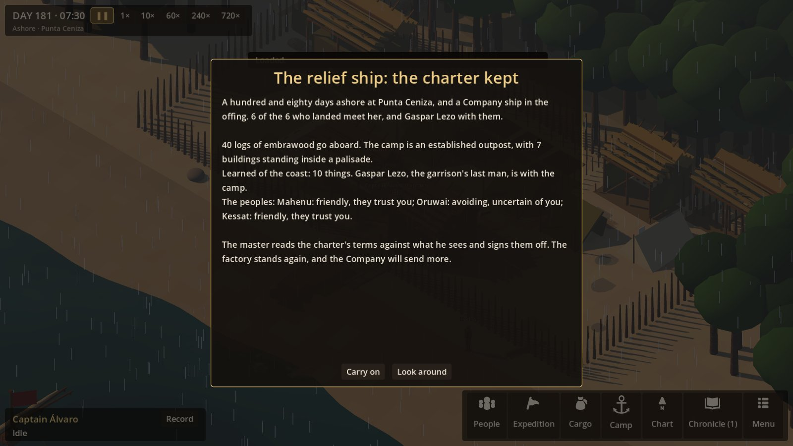
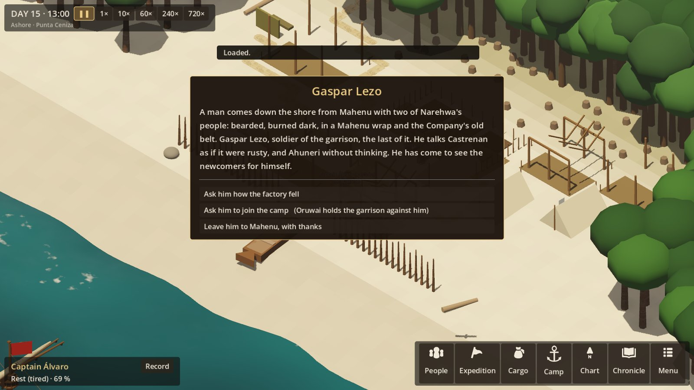

# The four settlement validation scenes, and the full arc to the relief ship

**Authority:** SETTLEMENT_EXPERIENCE §51 (four scenes, to prove the settlement before it is scaled),
§53 (acceptance), R8_THE_WORLD_AROUND (the charter and the relief ship).
**Status:** first pass, 2026-10-22. The arc is played to day 180 and judged for balance. All four
scenes are staged and judged. Each verdict is honest: **Yes**, **Partly** or **No**, against the tests
the spec names.

## How the arc is played, and the scenes staged

Meetings and parties wait for the captain, so a run to day 180 needs someone to answer them. The tests
have one: `TestCaptain` (tests only, not part of the game) answers the way a careful, decent captain
would:
- answers gifts with trade goods, or accepts with thanks when there is nothing to answer with;
- asks what they know, asks leave, explains the palisade;
- makes a few fair trades a meeting, never of the camp's tools;
- takes a theft up at the next meeting, and never holds anyone;
- gives the Brennish a letter, and sells them nothing;
- on day 3 orders huts for all, the storehouse, the infirmary, the workshop, the garden, the landing and
  the palisade;
- sends a party for the red wood once Oruwai gives leave, and again while the logs are short;
- goes up to Mahenu once the garrison's story is known, and takes Gaspar Lezo in once the wood is
  secured.

`FullArcTests.ACarefulCaptainAtPuntaCenizaKeepsTheCharter` plays it from landing to day 185 and holds
the result: the charter kept, four or more alive, six or more buildings, Gaspar with the camp, and
meetings that end.

The scenes are that same run, saved at each scene's moment and opened in the game. (They were captured
before the last fix below, to the store's room. The camp looks the same; only the logs differ.)

```
STAGE_SCENES=/some/folder dotnet test tests/Expedition.Simulation.Tests --filter StageScenes
-- --load=/some/folder/a-first-night.json          (b-two-weeks, c-crisis, d-established)
-- --load=/some/folder/d-established.json --panel=ship
-- --load=/some/folder/relief-eve.json --advance=150    (the relief ship's card)
-- --load=/some/folder/b-two-weeks.json --meeting=survivor    (Gaspar Lezo)
```

`--load=PATH` is new: it opens a save written anywhere, in place of a new campaign.

## The balance, played out

**First run: the careful captain could not win.** Four faults were found, all now fixed:
- **Meetings never ended.** Every option stayed open, so a captain could ask, ask again and trade all
  day: one Mahenu meeting ran for 30,000 exchanges. Now a question or a request for leave that is refused
  is not pressed again at the same meeting, and visitors go home of themselves after sixteen exchanges.
- **Asking Oruwai for leave over and over** cost trust each time: Oruwai's trust fell to −100 in a day.
  That is fixed by the same rule.
- **The camp traded away its axes** for logs, and then could build nothing: no hut stood by day 180.
  Now a tool is offered in trade, or as a gift, only while the camp keeps two of it. A trade of tools
  is marked with how many will be left.
- **The palisade stalled** at 60–90%: it uses poles, but the camp's call for poles counted only
  buildings. It now counts the palisade's stakes too.

- **Logs brought home were lost.** Ashore the camp's store still had the ship's hold's room, 3,000
  litres. The thatch for the roofs filled it, and a wood party's logs, finding no room, were silently
  dropped: 36 logs cut and none in store. Ashore the store is no longer limited: what is landed is
  stacked under cover, in the storehouse, or on the beach.

Two smaller fixes:
- **Leave for the wood** was offered by Mahenu, whose wood it is not. It is now asked only of Oruwai.
- **The camp panel** still said "the first days" on day 171. It now names the camp's stage.

**After the fixes**, the careful captain at Punta Ceniza (seeds 99282957, 7 and 1519):

| | Day 42 | Day 84 | Day 180 |
|---|---|---|---|
| Alive | 6 of 6, all seeds | 6 of 6, and Gaspar Lezo | the same |
| Buildings | 3 | 4–7 | 4–7 |
| Palisade | 70–100% | done | done |
| Logs | 0 | 45 | 40 go aboard |
| Oruwai | trading | wary or avoiding | avoiding or hostile |
| Charter | | | **kept**, all three seeds |

Gaspar Lezo stayed at Mahenu at the first asking (days 22–29), and was taken in on a second visit (days
74–94), once the wood was secured.

At the Río Bermejo (seed 99282957) all six live, and the charter is kept **in part**: it wants the
factory standing at Punta Ceniza, by design.

On seed 7 only four buildings stand by day 180: the storehouse, infirmary and workshop are still being
raised. Not yet looked into.

**What the numbers say:**
- **It is too safe for a careful captain.** No one died in four runs. Sickness spreads a dozen times
  and the storm comes on day 30, but the infirmary, the fever lore and full stores carry everyone
  through. The danger has to come from a careless captain, or from a wreck that lands fewer and worse
  hurt. Not changed in this pass: worth a second policy (a careless captain) before tuning.
- **Oruwai turns away by day 180** ("avoiding", on one seed "hostile"). The camp sits on Oruwai's
  ground; leave to stay wants trust 25, which this captain never quite reaches. Every day without leave
  adds grievance, and taking Gaspar in adds more. That is the headland question doing what it should.
  But nothing yet comes of a hostile Oruwai beyond thefts. A captain with no answer to it but to move
  the camp needs the move (R8's later pass).
- **Taking Gaspar in is a real trade-off.** In the first fixed run he joined on day 19, and Oruwai
  (−6 trust, +10 grievance) never trusted the camp enough again to give leave for the wood: 0 logs, the
  charter kept only in part. The captain now asks him once the wood is secured.
- **The trade chest runs out.** By day 170 gifts are being accepted unanswered. That is honest, but
  late in the run there is little to do at a meeting.
- **Axes wear out:** 3 at landing, 1 by day 60, sometimes none. The workshop mends, and the letter's two
  spare axes come only with the relief ship.

## Scene A: the first night — *Partly*



Day 1, 21:00, fourteen hours after landing at Punta Ceniza.

| Test | Verdict | Notes |
|---|---|---|
| Cargo continuity | **Partly** | The ship's chest and stores are ashore, and the Cargo screen lists them, but they cannot be seen in the night view: nothing marks the pile. |
| Survivor state | **Partly** | The same six who sailed, by name. No one is hurt in this run, so nothing marks the injured. Three are in the shelters, asleep. |
| Shelter | **Yes** | Three sailcloth shelters, rigged in the first hours. |
| Fire | **Yes** | The fire is the only light, and the captain keeps it. |
| Injury | **No** (not shown) | No one was hurt in the landing. The night needs a staging with someone hurt. |
| Exhaustion | **Partly** | Tiredness shows on the selected person's card, not on the figures. |

## Scene B: two weeks later — *Partly*



Day 15, 13:00.

| Test | Verdict | Notes |
|---|---|---|
| Work routines | **Partly** | The cooper and another are at the garden; the captain rests, tired. Most hands are out of frame, at the forest's edge or the spring. |
| Paths | **Yes** | Worn paths from the hearth to the plots, the garden and the landing, where people walked. |
| Storage | **Partly** | The storehouse's plot is marked and its posts are up. The stores are still under cover by the hearth. |
| Water | **Partly** | The spring is up on the headland, off this view; the trips to it show as a worn path leaving the frame. |
| Early construction | **Yes** | Plots marked, posts and frames up, garden beds dug, and the palisade begun. |

**A fault seen:** the palisade goes up before the huts. It was ordered on day 3 and is at 40% by day 21,
while no hut is roofed until about day 35. A captain would roof first. **To fix next:** the palisade
should wait until everyone has a berth under a roof.

## Scene C: the first crisis — *Partly*



Day 31, 09:00, two hours after the first storm of the wet season broke over the camp.

What happened, in the simulation:
- sickness was spreading from day 23;
- the storm came on day 30;
- sickness spread again on day 31;
- the stores ran short on day 41.

| Test | Verdict | Notes |
|---|---|---|
| Storm | **Partly** | Rain over everything, and the frames standing open to it. But a storm reads only as rain: the trees do not move, and nothing is torn. |
| Illness | **Partly** | Sickness is spreading in the simulation, but the figures do not show who is sick; only the People screen does. |
| Food shortage | **No** (not at this moment) | It comes ten days later. |
| Systems interacting | **Partly** | Wet, then sick, then short: the chain is real in the simulation. But no one died, and the camp was never in danger of failing. |

## Scene D: the established settlement — *Partly*




Day 171, 15:00, ten days before the relief ship.

| Test | Verdict | Notes |
|---|---|---|
| Visual progression | **Yes** | From three shelters to a ring of stakes round two huts, the storehouse, the infirmary, the workshop, the garden and the landing, with paths between. |
| Persistent founders | **Yes** | The six who landed, by name, and Gaspar Lezo with them. |
| Agriculture | **Partly** | The garden is there, but its beds are bare earth between crops in the wet season. The harvests are in the chronicle, not in the view. |
| Workshop | **Partly** | It stands, but cannot be told from a hut. |
| External relationship | **Partly** | The Camp screen tells how each people stands, what they want, and what they have told. The view shows them only when they come, as canoes on the beach. |
| Charter UI | **Yes** | The five terms ticked off, the days to the relief ship, and then its card. |

**Seen:** the hut roofs read as loose battens. The thatch stock is nearly used up by repairs, so the
huts are worn. That may be right, but it looks unfinished.

## The relief ship, and Gaspar Lezo



**The relief ship's card**, on day 180 when the charter is judged, gives:
- who meets her (those who landed, and anyone who joined since);
- the logs that go aboard;
- what the camp is;
- what was learned;
- how each people stands;
- the master's verdict: kept, kept in part with what is wanting, or void, and why.



**Gaspar Lezo** comes down from Mahenu after a party has met him there (R8_THE_WORLD_AROUND §12).

## Against §53

Newly shown by this pass:
- **construction uses labour, material, tools and time:** without axes, nothing is built.
- **external communities exist independently:** Oruwai drifts away on its own grievance.
- **sponsor charter remains relevant:** it shapes every choice in the run.
- **charter completion can be evaluated causally:** the card says what was wanting.

**Still open:**
- **first-day survival decisions matter:** not shown by a careful captain who never loses anyone;
- **deaths remain persistent:** no one died.

## Next

- **A careless-captain policy,** and runs with it: a refused gift, the palisade unexplained, a seizure, a
  wreck landing fewer. The balance cannot be judged on careful play alone.
- **The palisade after the roofs** (scene B).
- **The storm and the sick, in the view** (scene C): wind in the trees, torn sailcloth, the sick lying
  down.
- **The garden's crop, and a workshop that looks like one** (scene D).
