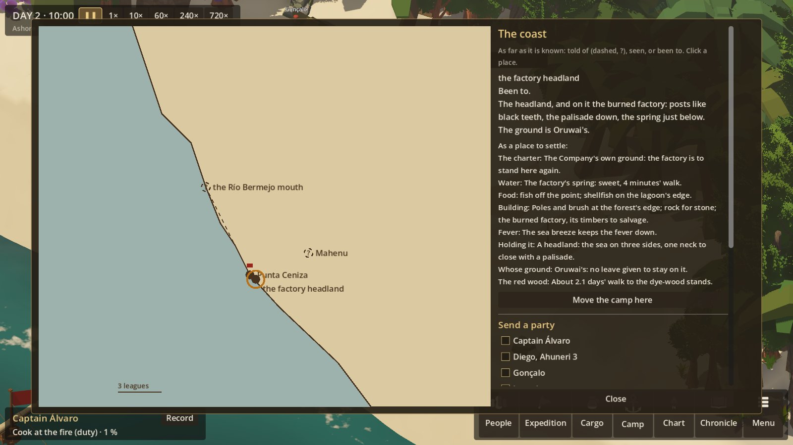
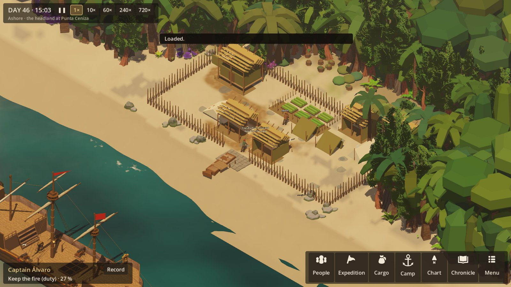

# The move: the first camp, a better site, the charter's ground

**Owner's ask:** "they should have to setup a camp initially, then explore more to find better suitable
locations where they were told to settle (higher score if settled where the sponsor says)".
**Spec:** ECONOMY_LOOP §11 ("Don't teleport resources globally"), §37 (exploration as an investment), §46
(relocation: "pack actual goods, move actual survivors and continue campaign history").
**Status:** first pass, 2026-10-22.

## The idea

The first camp is where the boat could land, not where the expedition was sent. At Punta Ceniza that is the
beach below the headland. The Company's charter wants the factory standing again on the headland itself,
where the burned ruin and its spring are.

So:
1. A party goes and looks the other site over.
2. The camp is moved there by its people.
3. Parties go back to fetch what could not be carried.

The camp left behind stays as it was: its buildings standing, and whatever was not carried still lying in its
stores.

## A survey

A party that comes to a landing site looks it over as a place to settle (`SimulationRunner.Survey`), and the
region map shows what it found:
- **The charter:** is this the Company's own ground?
- **Water:** the best source, sweet or brackish, and how far.
- **Food** near.
- **Building:** poles and brush, stone, a ruin's timbers.
- **Fever:** low ground and standing water, or the sea breeze.
- **Holding it:** a headland's one neck to wall, close growth, open shore.
- **Whose ground it is,** and whether leave has been given.
- **The red wood:** how far.

## The move

**The order:** "Move the camp here", on the region map, for any landing site whose way is known
(`SimulationRunner.MoveCamp`).

**Who goes and what they carry:**
- Everyone at the camp goes; the sick and hurt are carried, which slows the move by half.
- Each person carries a 25 kg pack, a half pack for each one carried.
- The boat takes 500 kg more if the way runs along the shore.
- **What goes first:** tools, then food that keeps, seed, water, what builds, trade goods, and what spoils
  last.

**What stays:** the old camp, as it stands:
- its buildings;
- its projects;
- its paths and garden;
- whatever was not carried, still in its own stores (`CampaignState.LeftCamps`).

**The ship:** if she is at anchor and the way is along the shore, she comes round to lie off the new camp, with
what is still aboard her.

**The new camp:**
- It has its own ground (CampGround) and its own store.
- What is known of the site is found already.
- The season is still counted from the first landing.
- A ruin's timbers already salvaged from another camp are gone here too.

**Going back:** moving back to an old camp takes it up again, as it was left.

## Fetching

"To fetch what was left at the old camp" is a party's purpose on the region map:
- The party goes with packs, and takes the boat along the shore; the camp is without the boat until they are
  back.
- They load up at the old camp: from its stores and, with the boat, from what is still in the ship or the
  wreck off it.
- They bring it home.

Nothing moves that no one carried.

## The charter

The charter's site is data (`"site"` in `data/region.json`'s charter): `coast.ceniza_headland`, the headland
at Punta Ceniza. Its term is now "the factory standing again on the headland at Punta Ceniza". A camp kept on
the beach below no longer meets it: the charter is kept only in part.

## In the simulation

**New:**
- `Shore.CampState.StoreId`: the inventory a camp's stores lie in.
- `CampaignState.LeftCamps`.
- `Journey.Loads` and `Journey.Boat`.
- `WorldState.Surveyed`.

All are saved, in format 41 as optional fields.

**Data:**
- The new site `coast.ceniza_headland` in `data/shore.json`: ground "headland", the spring 4 minutes away,
  less fever, the ruin.
- The place `place.factory` in `data/region.json`, a tenth of a day up from the beach.

**The test captain** camps on the beach, moves up to the headland on the second day, builds there, and fetches
whatever was left. `FullArcTests` still keeps the charter.

**Tests:** `MoveTests` (6):
- a survey;
- the move, with everything counted wherever it lies: nothing made or lost on the way;
- fetching by party and boat;
- moving back;
- the charter's term;
- save and load mid-move and after.

## Screenshots

## Not yet

- **The headland's own map:** it uses the beach's plan on its own ground. The cliffs, the sea on three sides
  and the ruin in the middle want a map of their own.
- **Stores within a camp are still one pool:** a worker takes poles from it wherever they stand (ECONOMY_AUDIT).
  Stores held in places inside the camp (the beach cache, the storehouse), with materials walked to the work,
  are the next pull request.
- **Choosing what to carry:** it is by the fixed order above, not chosen.
- **A left camp does not change while no one is there:** it does not wear, and is not robbed.
