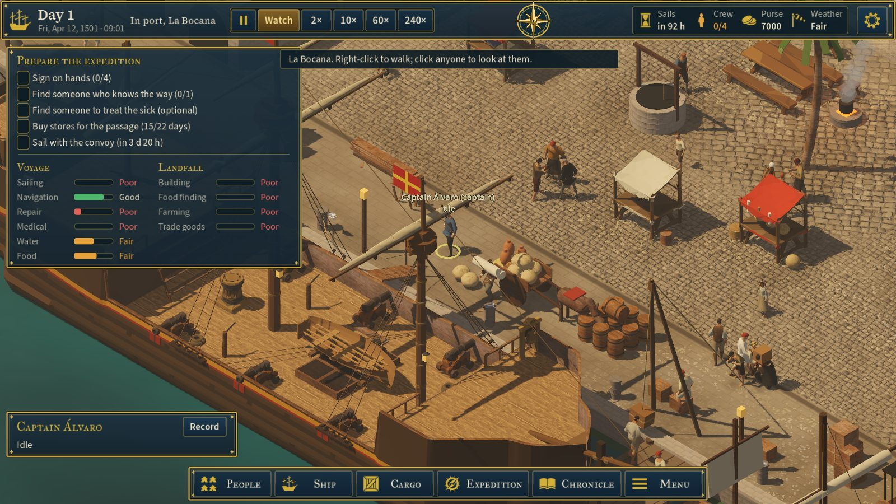
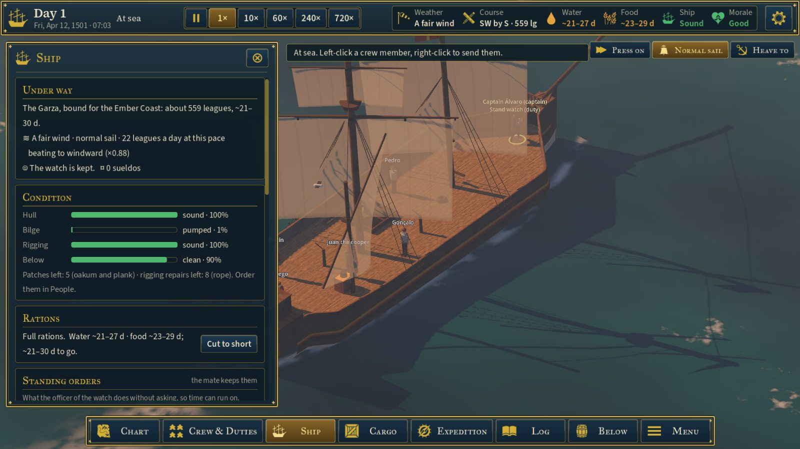
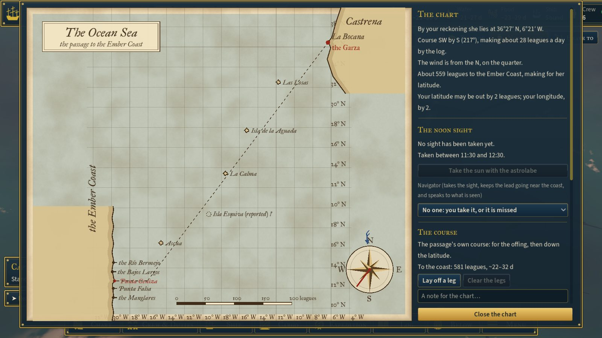
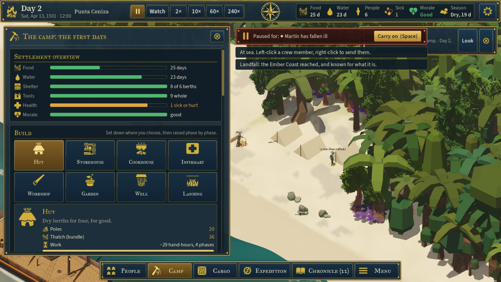
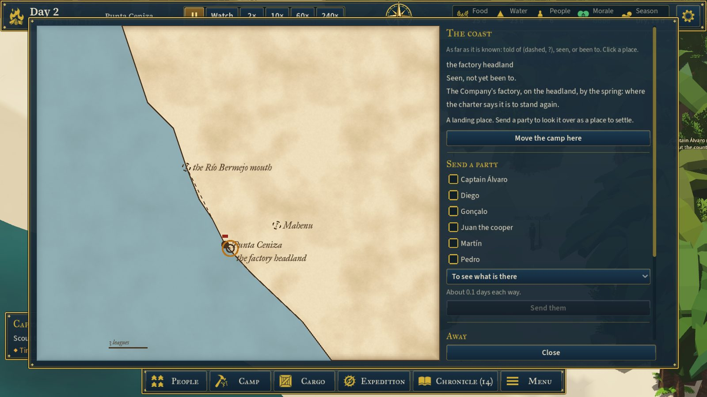
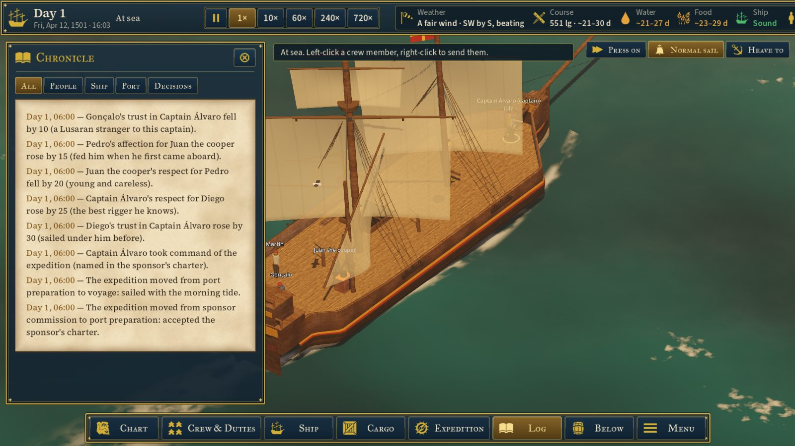

# The interface style: navy, gold and parchment

**Owner's ask:** "use these reference images we created to perform a drastic upgrade to the UI/UX
throughout … create a cohesive consistent UI/UX for the player. Don't worry about the portraits for now."
**References:** the owner's style guide sheet (palette, type, top bar, tabs, icons, buttons, panels), the
chart and navigation screen, and the three-phase mockup (port, voyage, settlement).
**Rules it keeps:** UI_UX_DESIGN_SYSTEM.md. The world keeps most of the screen. Colour always comes with
a word or an icon. Decorative type is never used for dense data. Readiness is given in words, not as a
score (ECONOMY_LOOP §43).
**Status:** first pass, 2026-10-22. All of it is in `game/Scripts/UiTokens.cs` and `Hud.cs`; every screen
takes its theme from `Ui.BuildTheme()`.

## The tokens (`Ui`)

**Palette** (the style guide's §1):

| Use | Colours |
|---|---|
| Primary | navy `#0E2A3A`, teal `#1E4B5A`, parchment `#EBD7B2`, gold `#D4AF37` |
| Secondary | wood, leather, stone, cloud |
| Status | good `#4DB86E`, warning `#E6A23C`, danger `#E0605A`, info `#4AA3DF` |
| Map | sea, land, explored, unknown |
| Grounds | panel, panel light, inset |

Text on navy is a warm cream (`Ui.Ink`). Text on parchment is a brown-black ink (`Ui.InkDark`).

**Type** (§2): all three families are SIL OFL, in `Assets/Fonts`.

| Face | Used for |
|---|---|
| IM FELL Great Primer SC | Titles, headings, tabs. Every gold heading is set in it. |
| IM FELL italic | Place names and the cartouche on charts. |
| Source Serif 4 | Reading text: events, endings, the chronicle, the place in the top bar. |
| Source Sans 3 | Labels, numbers, buttons, all the data. |

The day number is in the serif, because Fell's old-style "1" reads as an "I".

**Surfaces** (§7): drawn once into small textures in code; there are no image files.

- **Standard panel** (`Ui.Frame`): navy, darker at the foot, with a black edge, a gold double rule and gold
  points at the corners. Used for the bars, the drawers, the cards, the chart and the dialogs.
- **Parchment** (`Ui.ParchmentPanel`, `Ui.DrawParchment`): a seamless field of fibres and stains, browned
  toward its edges and ruled round. Used for the chart, the coast map and the chronicle.
- **Inset** (`Ui.InsetStyle`): a darker well with a faint gold rule. Used for sections inside a panel.
- **Notice** (`Ui.NoticeStyle`): the frame in dark red. Used for the paused notice and urgent alerts.

**Buttons** (§6), via `Ui.Button(kind, …)` or `Ui.Styled`. Each kind has normal, hover, pressed and
disabled states.

| Kind | Look | For |
|---|---|---|
| Secondary (the default) | Navy with a gold rule | Most buttons |
| Primary | Gold, dark text | The one thing to do here: place, carry on, close the chart |
| Tertiary | Slate | Quiet actions |
| Action | Blue | Something done in the world: taking the sun |
| Tab | Navy, the selected one bronze and gold | Tabs, the speeds, sail orders, the build menu's cards |

**Icons** (§5): 87 from Game-icons.net (CC BY 3.0; the credit is in `CREDITS.md`), fetched by
`tools/fetch_assets.py iconify` from the Iconify package on npm. They are saved as white SVGs, imported
at 128 px with mipmaps, and tinted where they are used (gold by default). `Ui.Icon(name)` makes a
TextureRect; `Ui.WithIcon(button, name)` puts one on a button. The ten Kenney PNGs they replace are gone,
along with `tools/make_icons.py`.

## The HUD

**The top bar** (the style guide's §3), across the whole width:
- **The day:** the ship (or the campfire ashore), "Day 9" over the date ("Fri, Apr 12, 1501 · 07:03"), and
  where she is.
- **The speeds:** one segmented control, the pause first.
- **The compass rose:** in the middle, drawn in gold (`CompassRose`). At sea a red pointer shows the
  course steered.
- **The readings:** each is an icon, a caption and a value, coloured by how it stands. Clicking one opens
  the screen that deals with it.
  - In port: the convoy, the crew signed on, the purse, the weather.
  - At sea: the weather, the course and leagues to go, water, food, the ship, the sick if there are any,
    morale, and the most pressing matter.
  - When the bar is too full, the readings drop their captions, and the rose steps aside when there is no
    room for it.
  - Ashore: food and water in days, the people, the sick, morale, the season.
- **The menu:** behind the gear.

Morale is new in the bar. It is a word (good, fair, low, breaking) from the strain the company carries.

**The tabs** (§4): centred along the foot. Each has an icon beside its name in small capitals, and the
open one is in gold. They change with the phase:

| Phase | Tabs |
|---|---|
| Port | People, Ship, Cargo, Expedition, Chronicle, Menu |
| At sea | Chart, Crew & Duties, Ship, Cargo, Expedition, Log, Below, Menu |
| Ashore | People, Camp (the build icon), Cargo, Expedition, Chronicle, Menu |

**Drawers:** framed, between the bars, with the screen's icon and title in the display face and a gold
close cross. Sail orders, alerts and notices sit under the top bar. The selected person's card sits
above the tabs.

## Each phase

**Port.** "Prepare the expedition" keeps its checklist and gains **readiness** in two columns, after
ECONOMY_LOOP §43:
- **Voyage:** sailing, navigation, repair, medical, water, food.
- **Landfall:** building, food finding, farming, trade goods.

Each row is a bar and a word (poor, weak, fair, good, strong), never one score. They come from the best
skills aboard and what is in the hold, and each tooltip says why. The person card is framed.

**At sea.**
- **The chart** is parchment, the sea washed blue, the land laid to the chart's edge with a darker shore.
  Names are in Fell italic.
- The chart has a cartouche ("The Ocean Sea", or "The Ember Coast" on the coast sheet), a scale in
  leagues, and an eight-pointed rose with the course and the wind.
- Beside it is a framed column. "Take the sun" is an action button, and "Close the chart" is gold.

**Ashore.** The Camp drawer opens on:
- **Settlement overview:** bars for food, water, shelter, tools, health and morale, each against what
  would be comfortable.
- **Build:** a card for each building, with its icon. The chosen one shows what it is for, every material
  its phases take (red where the stores are short) and the hand-hours, with a gold **Place** button.

The coast map is parchment too, with the sea in blue and the names in Fell italic.

**The chronicle** is written on parchment, the dates in brown ink. Its filters are tabs.

## Screenshots

## Not yet

- **Portraits** stay as they are (the owner's word).
- **The workplaces' assignments** (the mockup's lead and hands per workplace, with − and +) wait for
  step W, which gives workplaces leads.
- **The crew screen's skill bars and tabs** (the style guide's character card) keep the old layout in the
  new style.
- **The ship screen's cutaway with its hotspots** (the mockup's "Ship status") is not drawn as a picture;
  its condition bars are.
- **The context menu** (assign, prioritise, build, demolish, cancel) is not there yet: right-click still
  sends.
- **The other interface sizes** (90–130%, in the menu) have not been looked at in the new style. All of
  it was checked at 100%, at 1600 × 900.
