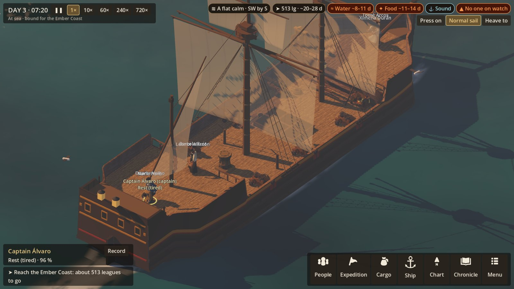
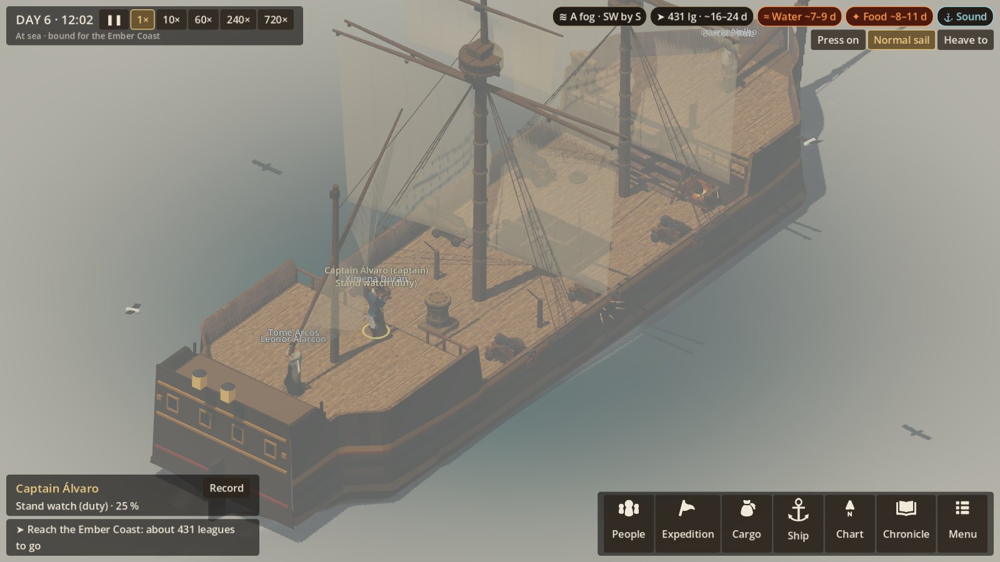
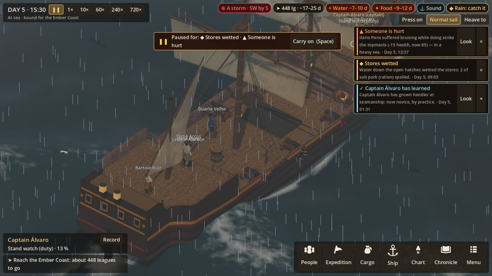
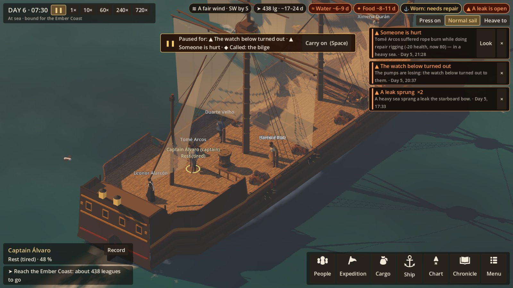

# R4h — The four voyage validation scenes

**Authority:** VOYAGE_EXPERIENCE §46 (four scenes, to be proved before voyage content is scaled), §31
(the ship's visible history), §33 (sound).
**Status:** first pass, 2026-10-22. All four scenes are staged and judged. Each verdict is honest:
**Yes**, **Partly** or **No**, against the tests the spec names.

## How to stage a scene

Each scene is staged the same way every time: seed 1519, six hands signed, the voyage sailed on to
the scene's day and hour. Fair weather is held until the scene's own weather begins, and any decision
is answered with its first choice.

```
-- --seed=1519 --hire=6 --sea --seastage=calm-morning   (fog, storm, aftermath)
```

## What was added for this pass

**The ship's visible history** (VOYAGE §31, `ShipView.ShowShipboard`). Before this she already showed
worn and ragged sails, holes in the hull and pale patches where it was mended, parted lines, and a
sprung yard. New:
- **Tarred tarpaulins** battened over the hatches, while the hatches are battened down.
- **Lashings** crossed over the casks, while the cargo is lashed.
- **A wet deck:** wet with rain and spray, drying over about four hours.
- **A grimy deck:** darker and stained as the ship goes unscrubbed, from the cleanliness kept in
  R4f.
- **Clothes drying** on a line in the shrouds, by day in fair weather for a while after rain or a
  blow.

**The ship's sounds at sea** (VOYAGE §33, `ShipSound.Sea`). Until now only the bell, rain, a line
parting and the yard springing could be heard at sea. New:
- **The sea along the hull, and the wind:** from the port's surf and wind recordings, by strength,
  the wind rising in pitch to a storm.
- **In fog:** the sea and wind are muffled, and the bell is rung every twenty seconds.
- **Her timbers creaking:** now and then in a calm, often in a seaway, with planks working in a storm.
- **The pumps' clank** while anyone is pumping.

## Scene A: the first calm morning at sea — *Partly*



Day 3, 07:20, a flat calm after fair weather.

| Test | Verdict | Notes |
|---|---|---|
| Routine life | **Partly** | Hands are about the deck, the galley fire is lit, and the sails hang slack in the calm. But the cook at his fire and the morning's washing of the decks cannot be told apart from anyone else at this distance. |
| Work animations | **Partly** | The figures stand at their work: there is still no work-specific animation (C-1 later). |
| Watch schedule | **No** (a fault found; fixed 2026-10-22: a hand walking to the helm at the change of watch now counts, and a test holds it to 3 minutes) | The pill reads **No one on watch** at 07:20. The day's work had begun, and the helm should have been manned first; it was not. Most likely the whole watch was too tired to start work after the night. **To fix next** in `HelmsmanFor`: someone must keep the helm, tired or not. |
| Ocean rendering | **Yes** | The calm reads as calm: a flat, glassy sea, long morning shadows, the ship's shadow on the water. |
| Ship soundscape | **Partly** | The sea is quiet, creaks come now and then, and the bell strikes the half hours. There are no voices or work sounds. |

## Scene B: fog and navigation uncertainty — *Partly*



Day 6, 12:02, in fog, at noon.

| Test | Verdict | Notes |
|---|---|---|
| Visibility | **Yes** | A grey wall closes round her and the far water is gone. The sea is flattened by the fog. |
| Navigation UI | **Yes** | The chart says the sun is hidden and there is no sight to be had today. The doubt goes on growing (R4a and R4b, finished). |
| Confidence system | **Yes** | The doubt ellipse, and the standing order to call the captain when the reckoning may be out by too much (R4c). |
| Lookout behaviour | **Partly** | The lookout's range is cut to about a tenth. But no one is shown at the masthead or the bow peering out: the lookout is only in the numbers. |
| Atmospheric audio | **Yes** | The sea and wind are muffled, and the fog bell sounds every twenty seconds. |

## Scene C: full storm emergency — *Partly*



Day 5, 15:30. A gale since 09:00, a storm since 12:00, with the standing order to make ready given.

| Test | Verdict | Notes |
|---|---|---|
| Weather | **Yes** | Driving rain, a dark sky, white water, spray at the bow. |
| Ship motion | **Partly** | She pitches and heels in the seaway, but not violently: kept restrained, as §32 asks, for control. |
| Alerts | **Yes** | Hands hurt, stores wetted, leaks: each says why ("in a heavy sea", "water down the open hatches"), with Look to go to the person. |
| Task prioritisation | **Partly** | The preparations were ordered as soon as the gale came. But the blow came without warning (it was forced), so the stores were wetted before the hatches were battened: that is right, but in a frame it reads only through the alert. |
| Damage cascade | **Yes** | Leaks are sprung, the bilge rises, the watch below is turned out to the pumps. On the deck, holed planks and the sails thinning. |
| Crew fatigue and injury | **Yes** | Bruising striking the topmasts, rope burn: each told with its cause. The worn out are slower and likelier hurt. |
| Readability | **Partly** | The alerts and pills stay readable in the storm. But **crew name labels overlap** when people stand together ("Tomé Arcos" over "Leonor Alarcón"). **To fix:** stack the labels, or show only the selected and the hurt. |

## Scene D: aftermath, damaged ship at dawn — *Partly*



Day 6, 07:30, after nine hours of storm. Fair since 22:00.

| Test | Verdict | Notes |
|---|---|---|
| Persistent visual damage | **Yes** | The sails are ragged and holed, and the hull holes and patches stay. "Worn: needs repair" and "a leak is open" in the pills. |
| Injured crew | **Yes** | The hurt rest with their conditions healing (R4f), and the People screen says how each mends. |
| Repair state | **Yes** | The Ship screen gives what is carried away, the leaks and how each was met, and the patches left. |
| Resource consequences | **Yes** | Water and food are down, and the verdict against the passage turns amber. |
| Emotional atmosphere | **Partly** | Morning light on a battered ship, and the alerts of the night still in the column. There is no music for the aftermath (§34), and nothing in the crew's bearing shows it. The clothes drying in the shrouds should show here and **cannot be seen in this frame**: to check. |
| Chronicle | **Yes** | The night's events are all recorded, with their causes, and the chart carries "A storm, day 5" where she met it. |

## What to do next, from these scenes

1. **The helm unmanned on a calm morning (A).** A sim fault: whoever stands watch must take the helm,
   tired or not, before others turn to.
2. **Overlapping crew labels (C).**
3. **Drying clothes not seen (D).** Check where the line hangs against the sails, and bring it into the
   iso view.
4. **The lookout shown (B):** a hand at the bow or masthead in fog and near the coast.
5. **Voices and work sounds (A, C):** calls, shouted orders, the pumps' crew.
6. **Music** for departure, crisis, aftermath and landfall (§34): to be chosen from the Artlist
   catalogue, with the owner's go-ahead.
