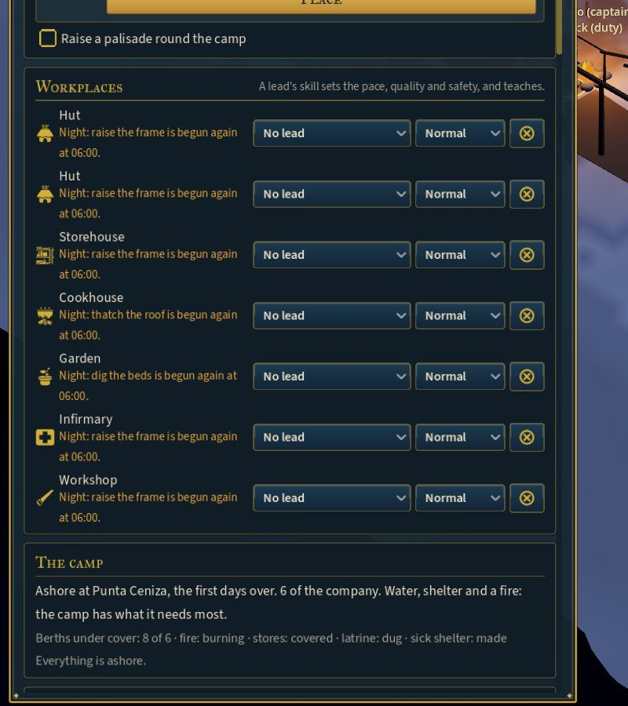
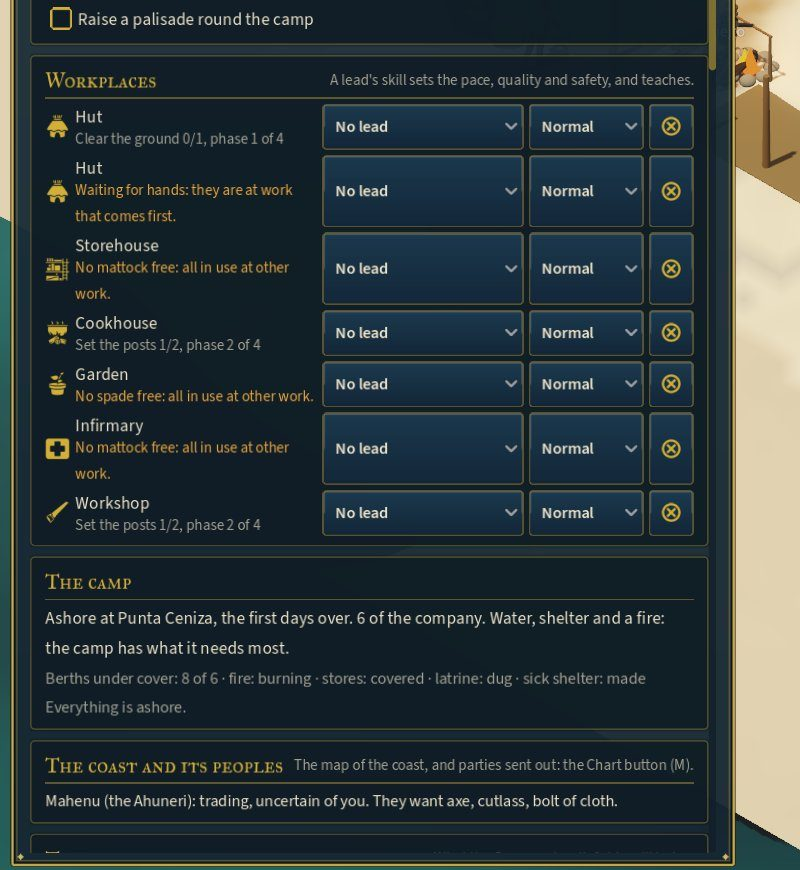

# Workplaces: leads, priorities, why work stops, the history of buildings

**Spec:** ECONOMY_LOOP §28 (bottlenecks named), §29 (priorities), §31 (workplaces led by a person) and §45
(buildings carry history). This is step W of ECONOMY_AUDIT.
**Status:** first pass, 2026-10-22. The simulation is in `World/SimulationRunner.Workplaces.cs`, and the
Camp drawer has a "Workplaces" card.

## Workplaces and their leads

Every building in hand, and every building standing, is a workplace. Each can have a **lead**: anyone of
the company (`SetLead(plot, person)`). A person leads one workplace at a time, so making them lead a new
one gives up the old.

While the lead is fit and at the camp, everyone working at that workplace gains:

| | How much | Where |
|---|---|---|
| **Pace** | +4% a level of the lead's skill in the work (carpentry, for building without a skill of its own) | `LeadPace` |
| **Quality** | Each hand's work comes out at least halfway to the lead's own, plus a little for the lead's eye | `LedQuality` |
| **Safety** | Accidents are 10% less likely a level, down to half | `LeadSafety` |
| **Teaching** | A hand learns from the lead as from a mentor, at 2.5×, up to the lead's own level, in the skill of the task. Whatever the task, they also pick up the lead's trade (carpentry) at half that. | `WorkplaceTeacher`, `Practise` |

A lead works at their own workplace first.

A veteran is worth having: the test hut built under a master carpenter comes out better made. Per hour on
the hut, the hands beside him learn more carpentry than they do without him.

## Priorities

Each project is **Critical**, **High**, **Normal** (the default), **Low** or **Paused** (`SetProjectPriority`).
- The hands take the highest priority that can be worked now, meaning work is left and the weather and
  materials allow it. A lower one waits until nothing above it can be worked. So a High project stalled
  for thatch does not hold up a Normal one that has its poles.
- **Critical** comes before every other duty of the camp. Rest and the needs of the body still come first:
  a priority cannot override them (§29).
- **Paused** is not worked at all.

With all seven buildings ordered at once, the camp spreads its one mattock, spade and adze over all of
them, and in 13 days none is finished. Priorities are how the captain chooses what not to do yet (§29).

## Why it has stopped

`Stalled(project)` says why no one is at a project, first cause first:
- **Paused.**
- **The storm**, or the weather.
- **Rain:** "Waiting for a dry spell: thatch the roof is not done in the rain."
- **The hours:** "Night: raise the frame is begun again at 06:00."
- **Materials:** "Waiting for poles: 4 more wanted."
- **Tools:**
  - "No mattock: 1 broken, waiting to be mended."
  - "No mattock free: all in use at other work."
- **Skill:** "No one here can raise the frame: it wants carpentry 2."
- **Duties:** "No one has thatch the roof among their duties."
- **Priority:** "Waiting: work of higher priority comes first."
- **Hands:** "Waiting for hands: they are at work that comes first."

The Camp drawer shows this in orange in place of the phase.

## The history of buildings

A project keeps who has worked on it and what has gone into it. The building it becomes keeps:
- when it was ordered and when it was finished;
- its lead (`BuiltUnder`) and its builders;
- its materials;
- what it has been through since: each storm (a storm of many hours is one entry, with all it took) and
  each repair.

`BuildingHistory(building)` gives it in lines, and the Camp drawer shows it under each building's
**History** button. For example:

> Built day 14, begun day 9.
> Led by Juan the cooper.
> Built by Diego, Pedro and Martín.
> From 20 poles and 36 thatch (bundle).
> Weathered the storm of day 31 (−12).
> Repaired day 33 (+12).

## In the game

The Camp drawer's **Workplaces** card, under the build menu, has a row for each project and each standing
building. Each row has its icon, its name and how it stands (the phase, or why it waits), then:
- the lead, chosen from the company (each with their carpentry);
- for a project, its priority and the cross to give it up;
- for a building, its History.

## Saves

Format 42:
- projects keep their priority, lead, begun time, builders and materials;
- buildings keep their lead, builder, begun and built times, builders, materials and history.

Older saves load with ordinary priorities, no leads and no history (shown as "Built before buildings kept
their history").

## Tests

`WorkplaceTests` (8):
- the record of a building built under a lead;
- a skilled lead making better work and teaching;
- one workplace a person;
- paused and low waiting;
- a critical project taken up;
- why work stops: no mattock, no poles, night;
- a storm and a repair in the history;
- all of it saved and loaded alike.

## Not yet

- **Leads for the camp's other work** (the hearth, the water, the garden as a whole) and at sea (the watch
  officers already lead the watches).
- **The test captain** does not appoint leads or set priorities, so the day-180 balance is as it was.
- **A lead's own record:** "led the storehouse" is not yet in their life.
